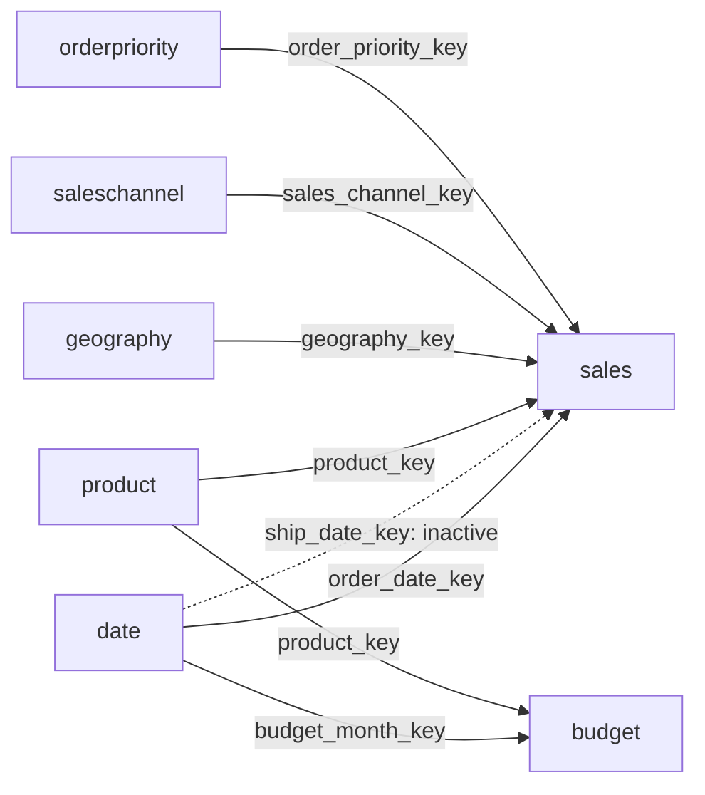
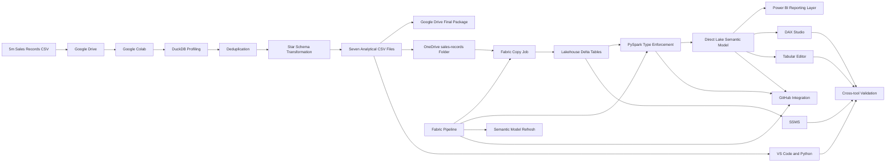

# Sales Records Fabric Analytics

[](https://www.microsoft.com/microsoft-fabric)
[](https://powerbi.microsoft.com/)
[](https://www.python.org/)
[](https://learn.microsoft.com/fabric/data-engineering/lakehouse-sql-analytics-endpoint)
[](https://learn.microsoft.com/dax/)
[](LICENSE)

An end-to-end Microsoft Fabric data engineering and analytics project that transforms a synthetic five-million-row sales dataset into a validated dimensional model with automated ingestion, Delta Lake storage, Direct Lake semantic modeling, monthly product budgeting, and cross-tool reconciliation.

The project demonstrates how Microsoft Fabric can be integrated with Google Colab, OneDrive, GitHub, DAX Studio, Tabular Editor, SQL Server Management Studio, and Visual Studio Code to create a reproducible analytics workflow with a strong emphasis on data quality.

---

## Table of contents

- [Project overview](#project-overview)
- [Business use cases](#business-use-cases)
- [Project objectives](#project-objectives)
- [Source dataset](#source-dataset)
- [Data-quality discovery](#data-quality-discovery)
- [Google Colab transformation](#google-colab-transformation)
- [Dimensional model](#dimensional-model)
- [Budget model](#budget-model)
- [Solution architecture](#solution-architecture)
- [Microsoft Fabric implementation](#microsoft-fabric-implementation)
- [Automated pipeline](#automated-pipeline)
- [Data-type enforcement](#data-type-enforcement)
- [Direct Lake semantic model](#direct-lake-semantic-model)
- [DAX measures](#dax-measures)
- [Developer-tool integration](#developer-tool-integration)
- [Data-quality strategy](#data-quality-strategy)
- [Verified results](#verified-results)
- [GitHub integration](#github-integration)
- [Repository structure](#repository-structure)
- [Reproduction workflow](#reproduction-workflow)
- [Operational considerations](#operational-considerations)
- [Skills demonstrated](#skills-demonstrated)
- [Limitations](#limitations)
- [License](#license)

---

## Project overview

The original source was a single flat CSV file containing:

```text
5,000,000 sales records
```

The project transforms that source into a governed analytical solution containing:

- a deduplicated sales fact table,
- a product-month budget fact table,
- five shared dimensions,
- a Microsoft Fabric Lakehouse,
- typed Delta tables,
- an automated Fabric pipeline,
- a Direct Lake semantic model,
- reusable DAX measures,
- SQL, DAX, and Python reconciliation tests,
- GitHub-integrated Fabric definitions,
- external development and analytical tool integration.

The finished solution supports repeatable ingestion, model refresh, Actual versus Budget analysis, profitability analysis, delivery-time analysis, and independent validation across several analytical engines.

---

## Business use cases

The model supports the following analytical scenarios.

### Executive performance monitoring

- Total revenue
- Total cost
- Total profit
- Profit margin
- Units sold
- Order count
- Average order value

### Actual versus Budget analysis

- Actual revenue versus budget revenue
- Actual profit versus budget profit
- Revenue variance
- Revenue variance percentage
- Profit variance
- Profit variance percentage
- Revenue budget attainment
- Profit budget attainment

### Product analysis

- Product revenue and profitability
- Product-level monthly budgets
- Units sold by product
- Product contribution to total profit
- Actual versus Budget comparison by product

### Geographic analysis

- Revenue by country
- Profit by region
- Product performance across geographic markets
- Regional contribution to total sales

### Sales-channel analysis

- Online versus offline revenue
- Channel profitability
- Units sold by channel
- Channel contribution to total performance

### Delivery analysis

- Average delivery time
- Revenue by order date
- Revenue by ship date
- Delivery duration by product, country, or priority

### Operational analysis

- Order-priority performance
- Delivery time by priority
- Profitability by sales channel
- Monthly and yearly sales trends

---

## Project objectives

The project was designed to:

- transform a flat sales file into a dimensional star schema,
- identify and remove exact duplicate transactions,
- preserve valid business keys and financial values,
- enrich the source with delivery and profitability attributes,
- generate a monthly product-level budget,
- support Actual versus Budget reporting,
- automate ingestion from OneDrive to Microsoft Fabric,
- enforce correct Delta table data types,
- refresh the semantic model automatically,
- validate identical results through Python, SQL, and DAX,
- use professional external development tools,
- synchronize supported Fabric definitions with GitHub,
- maintain a documented and reproducible project structure.

---

## Source dataset

The project uses the synthetic **5m Sales Records** dataset:

[Sales Records sample dataset download page](https://excelbianalytics.com/downloads-18-sample-csv-files-data-sets-for-testing-sales/)

The original source contains the following columns:

| Source column | Description |
|---|---|
| Region | Geographic sales region |
| Country | Country in which the order was placed |
| Item Type | Product type |
| Sales Channel | Online or offline sales channel |
| Order Priority | Critical, High, Medium, or Low |
| Order Date | Date on which the order was placed |
| Order ID | Source order identifier |
| Ship Date | Date on which the order was shipped |
| Units Sold | Number of units sold |
| Unit Price | Revenue per unit |
| Unit Cost | Cost per unit |
| Total Revenue | Units Sold multiplied by Unit Price |
| Total Cost | Units Sold multiplied by Unit Cost |
| Total Profit | Total Revenue minus Total Cost |

> The source data is synthetic and is intended for technical testing, data engineering, and analytics practice.

Large source and output data files are intentionally excluded from this repository.

---

## Data-quality discovery

Initial profiling identified a critical source-quality issue.

| Validation check | Result |
|---|---:|
| Original source rows | 5,000,000 |
| Distinct complete rows | 2,097,152 |
| Exact duplicate rows | 2,902,848 |
| Conflicting duplicate Order IDs | 0 |
| Maximum occurrences of one Order ID | 3 |

The duplicated rows were identical across all 14 source columns.

Keeping the duplicates would have overstated:

- revenue,
- cost,
- profit,
- units sold,
- order counts,
- product performance,
- geographic performance,
- sales-channel performance.

The raw source was preserved unchanged. The analytical model was built from:

```text
2,097,152 unique transactions
```

The reconciliation was:

```text
5,000,000 original rows
- 2,902,848 exact duplicate rows
= 2,097,152 valid analytical rows
```

---

## Google Colab transformation

Google Colab and DuckDB were used to profile, clean, transform, test, and export the source data.

DuckDB enabled efficient processing of the large CSV without requiring the entire dataset to be loaded into a pandas DataFrame.

### Transformation stages

1. Connect Google Colab to Google Drive.
2. Locate and validate the five-million-row source CSV.
3. Verify the expected 14-column schema.
4. Profile all source rows.
5. Check null values and required fields.
6. Validate order and shipping dates.
7. Validate numeric values.
8. Verify revenue calculations.
9. Verify cost calculations.
10. Verify profit calculations.
11. Analyze repeated Order IDs.
12. Distinguish exact duplicate rows from conflicting transactions.
13. Remove only exact duplicates.
14. Standardize names using `snake_case`.
15. assign appropriate date and numeric types.
16. Create surrogate dimension keys.
17. Create the five dimension tables.
18. Build the sales fact table.
19. Generate the product-month budget.
20. Validate primary keys and foreign keys.
21. Detect orphan records.
22. Reconcile financial totals.
23. Export the seven final analytical tables.

### Added analytical attributes

The sales fact table was enriched with:

| Added column | Description |
|---|---|
| `delivery_days` | Number of days between order and shipment |
| `unit_margin` | Unit price minus unit cost |
| `profit_margin_pct` | Total profit divided by total revenue |

Technical surrogate keys were also created for the fact and dimension tables.

---

## Dimensional model

The final model contains two fact tables and five dimensions.

### Fact table: `sales`

Grain:

> One row per unique sales order.

Final row count:

```text
2,097,152
```

Main columns include:

- `sales_key`
- `order_id`
- `order_date_key`
- `ship_date_key`
- `product_key`
- `geography_key`
- `sales_channel_key`
- `order_priority_key`
- `units_sold`
- `unit_price`
- `unit_cost`
- `total_revenue`
- `total_cost`
- `total_profit`
- `delivery_days`
- `unit_margin`
- `profit_margin_pct`

### Fact table: `budget`

Grain:

> One product per month.

Final row count:

```text
1,404
```

Main columns include:

- `budget_key`
- `budget_month_key`
- `product_key`
- `budget_units`
- `budget_revenue`
- `budget_cost`
- `budget_profit`
- `budget_profit_margin_pct`
- `budget_version`
- growth-factor metadata
- budget-generation method

### Dimension tables

| Dimension | Purpose | Rows |
|---|---|---:|
| `date` | Continuous calendar covering order and shipping dates | 3,956 |
| `product` | Product types and reporting names | 12 |
| `geography` | Country and region combinations | 185 |
| `saleschannel` | Online and offline sales channels | 2 |
| `orderpriority` | Critical, High, Medium, and Low priorities | 4 |

---

## Budget model

The source dataset did not include a budget table.

A synthetic budget was added to support realistic Actual versus Budget analysis.

The budget is maintained at product-month granularity:

```text
One product × one month
```

Budget values were generated from prior-year actual performance.

| Budget metric | Growth factor |
|---|---:|
| Units | 1.03 |
| Revenue | 1.05 |
| Cost | 1.04 |
| Profit | Budget Revenue minus Budget Cost |

The budget intentionally does not include geography, sales channel, or order priority.

This prevents false precision and reflects a realistic scenario in which an organization plans product-level monthly targets but records actual transactions at a much more detailed level.

Shared `date` and `product` dimensions allow Actual and Budget values to be analyzed together without changing the native budget grain.

---

## Star schema



The model uses:

- one-to-many relationships,
- single-direction filtering from dimensions to facts,
- an active sales order-date relationship,
- an inactive sales ship-date relationship,
- shared Date and Product dimensions,
- separate native grains for Actual and Budget.

---

## Solution architecture



---

## Microsoft Fabric implementation

### Fabric workspace

The `Sales Records Analytics` workspace contains:

- `CopyJob_1`
- `Fix_Sales_Records_Data_Types`
- `Load_Sales_Records`
- `Sales Records Model`
- `SalesRecordsLakehouse`
- Lakehouse SQL Analytics Endpoint

The workspace is connected to the `main` branch of the GitHub repository.


---

## Automated pipeline

The Fabric pipeline orchestrates the complete load and refresh process:

```text
Copy Job
   ↓
Data-Type Enforcement Notebook
   ↓
Semantic Model Refresh
```

### Copy Job

The Copy Job:

- connects to OneDrive through the SharePoint Folder connector,
- reads all seven final CSV files,
- maps every file to a separate Lakehouse table,
- writes data to the Lakehouse `Tables` area,
- uses a full replacement strategy.

The write configuration is:

```text
Full copy + Overwrite
```

This configuration prevents repeated runs from appending duplicate copies of the same source rows.

### Type-enforcement notebook

The notebook executes only after ipeline.png

---

## Data-type enforcement

CSV files do not persist a physical schema.

The initial Copy Job therefore imported all CSV values as strings. This was detected before completing the semantic model.

The `Fix_Sales_Records_Data_Types` Fabric notebook converts the columns to appropriate Delta types after every ingestion.

| Column category | Target type |
|---|---|
| Technical fact keys | `BIGINT` |
| Dimension keys | `INT` |
| Dates | `DATE` |
| Unit values | `DECIMAL(18,2)` |
| Financial values | `DECIMAL(18,2)` |
| Margin percentages | `DECIMAL(18,4)` |
| Budget growth factors | `DECIMAL(6,4)` |
| Weekend flag | `BOOLEAN` |
| Descriptive values | `STRING` |

This design preserves portable CSV sources while ensuring that the analytical Lakehouse uses a controlled schema.

---

## Direct Lake semantic model

The semantic model uses Direct Lake over Delta tables stored in OneLake.

The model includes:

- two fact tables,
- five dimensions,
- seven active relationships,
- one inactive ship-date relationship,
- a marked Date table,
- chronological sorting,
- a dedicated `_Measures` table,
- organized measure display folders.

### Relationship design

Active relationships:

- `date[date_key]` to `sales[order_date_key]`
- `product[product_key]` to `sales[product_key]`
- `geography[geography_key]` to `sales[geography_key]`
- `saleschannel[sales_channel_key]` to `sales[sales_channel_key]`
- `orderpriority[order_priority_key]` to `sales[order_priority_key]`
- `date[date_key]` to `budget[budget_month_key]`
- `product[product_key]` to `budget[product_key]`

Inactive relationship:

- `date[date_key]` to `sales[ship_date_key]`

### Date-table configuration

The Date table contains:

- date key,
- full date,
- year,
- quarter,
- month,
- year-month,
- week number,
- day of month,
- weekday,
- weekend flag,
- month start date,
- month end date.

Configured sorting includes:

- month name by month number,
- abbreviated month name by month number,
- quarter name by quarter number,
- weekday name by weekday number,
- year-month by month start date.

---

## DAX measures

The `_Measures` table contains measures grouped into Sales, Budget, Shipping, and Variance display folders.

### Sales measures

- Total Revenue
- Total Cost
- Total Profit
- Profit Margin %
- Units Sold
- Order Count
- Average Order Value
- Average Delivery Days

### Shipping measure

- Revenue by Ship Date

The shipping measure uses `USERELATIONSHIP` to activate the inactive ship-date relationship.

### Budget measures

- Budget Revenue
- Budget Cost
- Budget Profit
- Budget Units

### Variance measures

- Revenue Variance
- Revenue Variance %
- Profit Variance
- Profit Variance %
- Revenue Budget Attainment %
- Profit Budget Attainment %

All core measures were validated against the verified SQL and Python totals.

---

## Developer-tool integration

The project demonstrates an effective development workflow around Microsoft Fabric rather than limiting development to the Fabric browser experience.

### SQL Server Management Studio

SQL Server Management Studio connects to the Lakehouse SQL Analytics Endpoint.

SSMS was used to validate:

- table accessibility,
- row counts,
- financial totals,
- SQL data types,
- Lakehouse endpoint behavior,
- source-to-destination reconciliation.

The SQL results were compared with Google Colab, Python, and DAX results.

docs/images/03_ssms_sql_endpoint.png

### DAX Studio

DAX Studio connects to the semantic model through the workspace XMLA endpoint.

DAX Studio was used to validate:

- semantic-model row counts,
- total revenue,
- total cost,
- total profit,
- order count,
- budget values,
- variance calculations,
- Actual versus Budget results,
- filter propagation through Date and Product,
- correct operation of the inactive shipping-date relationship.

docs/images/04_dax_studio.png

### Tabular Editor

Tabular Editor was used to inspect and improve the Power BI semantic model.

Tasks included:

- inspecting table metadata,
- inspecting relationship metadata,
- reviewing DAX measure definitions,
- organizing measures into display folders,
- checking the Date-table configuration,
- reviewing the Direct Lake model structure,
- running Best Practice Analyzer,
- verifying unresolved model-quality issues.

The standard Power BI Best Practice Analyzer rules were applied to the model.

docs/images/05_tabular_editor.png

### Visual Studio Code and Python

Visual Studio Code was used to validate the final local CSV files independently of Microsoft Fabric.

The Python validation script uses:

- `csv.DictReader`
- `decimal.Decimal`
- `pathlib.Path`
- controlled decimal precision
- explicit expected row counts
- explicit expected financial totals

The script verifies:

- presence of all seven files,
- row count for every file,
- sales revenue,
- sales cost,
- sales profit,
- budget revenue,
- budget cost,
- budget profit,
- final PASS or FAIL status.

This validation provides independent evidence that the final source package matches the values stored in Fabric and exposed through the semantic model.

docs/images/06_visual_studio_code.png

---

## Data-quality strategy

Data quality is a central part of the project rather than a final reporting check.

Controls are applied at several layers.

### Source-level controls

- expected source schema,
- source row count,
- null-value checks,
- duplicate Order ID analysis,
- exact duplicate detection,
- conflicting transaction detection.

### Business-rule controls

- shipping date is not before order date,
- units sold are positive,
- unit prices and costs are nonnegative,
- total revenue equals units sold multiplied by unit price,
- total cost equals units sold multiplied by unit cost,
- total profit equals revenue minus cost.

### Dimensional-model controls

- surrogate keys are unique,
- primary keys are not null,
- fact foreign keys are not null,
- no orphan dimension references exist,
- sales Order IDs remain unique after deduplication,
- product-month budget combinations are unique.

### Export controls

- source table row counts match CSV exports,
- source table row counts match Parquet exports,
- all expected files exist,
- no unexpected files exist in the final source package.

### Fabric controls

- Copy Job completes successfully,
- the notebook runs only after the Copy Job succeeds,
- typed tables preserve all row counts,
- SQL financial totals match source totals,
- semantic-model refresh runs only after successful type conversion.

### Semantic-model controls

- shared dimensions filter both fact tables,
- Date and Product filters affect Actual and Budget correctly,
- the inactive shipping relationship is activated only by the required measure,
- DAX totals match SQL totals,
- DAX variance calculations reconcile independently.

### External controls

- SSMS validates SQL results,
- DAX Studio validates semantic-model results,
- Tabular Editor validates model metadata,
- Visual Studio Code validates final CSV source files,
- GitHub stores supported version-controlled definitions.

The process follows a strict rule:

```text
Do not continue when a critical validation returns FAIL.
```

---

## Validation strategy

Validation was performed with multiple independent engines.

| Validation layer | Tool | Purpose |
|---|---|---|
| Source engineering | Google Colab and DuckDB | Profiling, deduplication, transformation, formula reconciliation |
| Lakehouse storage | Fabric Notebook and PySpark | Schema enforcement and row-count validation |
| SQL endpoint | SSMS and T-SQL | Table counts and financial aggregates |
| Semantic model | DAX Query View and DAX Studio | Relationships, measures, filters, Actual versus Budget |
| Local source package | Visual Studio Code and Python | Independent CSV validation |
| Model metadata | Tabular Editor | DAX inspection and Best Practice Analyzer |
| Version control | GitHub | Fabric definition tracking and project documentation |

Using multiple engines reduces the risk of accepting an error that exists only because the same processing logic was reused everywhere.

---

## Verified results

### Sales

| Metric | Verified result |
|---|---:|
| Rows | 2,097,152 |
| Distinct orders | 2,097,152 |
| Revenue | 2,791,311,290,134.26 |
| Cost | 1,967,789,425,687.73 |
| Profit | 823,521,864,446.53 |
| Profit margin | 29.50% |
| Units sold | 10,486,803,584 |
| Average order value | 1,331,000.94 |
| Average delivery time | 25.00 days |

### Budget

| Metric | Verified result |
|---|---:|
| Rows | 1,404 |
| Revenue | 2,671,195,633,124.52 |
| Cost | 1,865,176,353,940.69 |
| Profit | 806,019,279,183.83 |
| Budget units | 9,844,570,623 |

### Actual versus Budget

| Metric | Verified result |
|---|---:|
| Revenue variance | 120,115,657,009.74 |
| Revenue variance % | 4.50% |
| Revenue budget attainment | 104.50% |
| Profit variance | 17,502,585,262.70 |
| Profit variance % | 2.17% |
| Profit budget attainment | 102.17% |

### Cross-tool validation

```text
Google Colab                 PASS
DuckDB                       PASS
Fabric Copy Job              PASS
Fabric Notebook              PASS
Fabric SQL Analytics Endpoint PASS
Semantic Model Refresh       PASS
DAX Query View               PASS
DAX Studio                   PASS
SQL Server Management Studio PASS
Visual Studio Code / Python  PASS
Tabular Editor BPA           PASS
```

The following results matched across SQL, DAX, and Python:

- sales row count,
- budget row count,
- total revenue,
- total cost,
- total profit,
- budget revenue,
- budget cost,
- budget profit.

---

## GitHub integration

The Microsoft Fabric workspace is connected to this GitHub repository.

Supported Fabric definitions are synchronized with the `main` branch.

The repository stores definitions for:

- Copy Job,
- Data Pipeline,
- Notebook,
- Lakehouse,
- Semantic Model.

The following items are intentionally excluded:

- OneLake data,
- full source CSV files,
- generated analytical CSV files,
- credentials,
- personal access tokens,
- private connection strings,
- local user paths,
- private endpoint information,
- pipeline execution history.

This separation keeps the repository secure while preserving the technical definitions required to inspect and reproduce the solution.

---

## Repository structure

```text
.
├── CopyJob_1.CopyJob/
├── Fix_Sales_Records_Data_Types.Notebook/
├── Load_Sales_Records.DataPipeline/
├── Sales Records Model.SemanticModel/
├── SalesRecordsLakehouse.Lakehouse/
├── docs/
│   └── images/
│       ├── 01_fabric_workspace.png
│       ├── 02_fabric_pipeline.png
│       ├── 03_ssms_sql_endpoint.png
│       ├── 04_dax_studio.png
│       ├── 05_tabular_editor.png
│       └── 06_visual_studio_code.png
├── LICENSE
└── README.md
```

---

## Reproduction workflow

1. Download the synthetic 5m Sales Records dataset.
2. Store the source CSV in Google Drive.
3. Connect Google Colab to Google Drive.
4. Profile the complete source using DuckDB.
5. Detect and remove only exact duplicate rows.
6. Validate dates, numeric values, and financial formulas.
7. Create the five dimension tables.
8. Create the sales fact table.
9. Generate the product-month budget table.
10. Validate primary keys and foreign keys.
11. Export the seven final analytical CSV files.
12. Upload the final files to the OneDrive `sales-records` folder.
13. Create the Microsoft Fabric workspace and Lakehouse.
14. Configure the OneDrive Copy Job.
15. Configure `Full copy + Overwrite`.
16. Add the type-enforcement notebook.
17. Add the semantic-model refresh activity.
18. Create the Direct Lake semantic model.
19. Configure table relationships.
20. Configure the marked Date table and sorting.
21. Create the DAX measure table.
22. Validate measures through DAX Query View.
23. Connect DAX Studio through the XMLA endpoint.
24. Connect Tabular Editor through the XMLA endpoint.
25. Connect SSMS to the SQL Analytics Endpoint.
26. Validate the local files with Python in Visual Studio Code.
27. Connect the Fabric workspace to GitHub.
28. Commit supported project definitions and documentation.

---

## Operational considerations

The source remains CSV-based for portability.

Because CSV does not persist physical data types, the pipeline must preserve this execution sequence:

```text
Copy Job
   ↓
Type-Enforcement Notebook
   ↓
Semantic Model Refresh
```

Running the Copy Job without the notebook could overwrite correctly typed Delta tables with string-based columns.

This could affect:

- numerical aggregation,
- relationship compatibility,
- model refresh,
- DAX calculations,
- downstream reporting.

The pipeline dependencies ensure that:

- the notebook runs only after a successful copy,
- the semantic model refresh runs only after successful type enforcement,
- failed upstream activities prevent invalid downstream refreshes.

---

## Effective tool selection

Each tool was used for the workload for which it was best suited.

| Tool | Effective project use |
|---|---|
| Google Colab | Accessible processing environment for source engineering |
| DuckDB | Efficient large-CSV querying, profiling, and transformation |
| Google Drive | Persistent storage for Colab source and final outputs |
| OneDrive | Governed source location for Fabric ingestion |
| Fabric Copy Job | Repeatable source-to-Lakehouse data movement |
| Fabric Lakehouse | Delta storage and SQL analytics access |
| Fabric Notebook | PySpark schema enforcement and validation |
| Fabric Pipeline | Orchestration and dependency management |
| Direct Lake | High-performance semantic access to OneLake data |
| DAX Query View | In-browser relationship and measure testing |
| DAX Studio | External DAX validation through XMLA |
| Tabular Editor | Professional semantic-model inspection and BPA |
| SSMS | SQL endpoint validation and reconciliation |
| Visual Studio Code | Local Python validation and project scripting |
| GitHub | Version control, documentation, and portfolio publication |

---

## Skills demonstrated

- Microsoft Fabric
- OneLake
- Fabric Lakehouse
- Delta Lake
- Data Factory Pipeline
- Copy Job
- Fabric Notebook
- PySpark
- Direct Lake
- Power BI semantic modeling
- DAX
- TMDL
- SQL
- Python
- DuckDB
- Google Colab
- Google Drive
- OneDrive
- SharePoint Folder connector
- DAX Studio
- Tabular Editor
- Best Practice Analyzer
- SQL Server Management Studio
- Visual Studio Code
- XMLA endpoint
- GitHub integration
- Dimensional modeling
- Data-quality engineering
- Reconciliation testing
- Actual versus Budget analysis
- Developer-tool integration
- Analytics workflow automation

---

## Limitations

- The source data is synthetic and does not represent real commercial activity.
- Budget values are generated using predefined prior-year growth assumptions.
- The source does not contain individual customers, physical stores, or product SKUs.
- Budget data is maintained at product-month granularity.
- Geography and sales-channel budget allocation are outside the current project scope.
- CSV files do not persist physical data types.
- The project was developed using Microsoft Fabric Trial capacity.
- Git synchronization stores supported definitions, not OneLake data.
- Credentials and private connections must be recreated after deployment.
- A final Power BI report can be developed as a separate presentation layer over the validated semantic model.

---

## License

This project is licensed under the MIT License.

LICENSE
