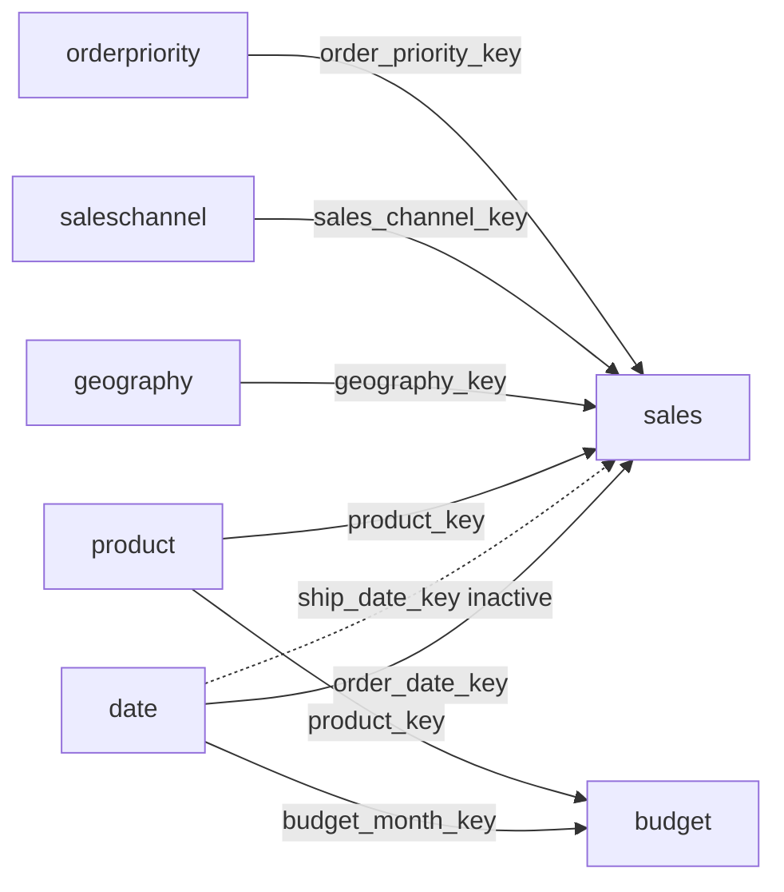
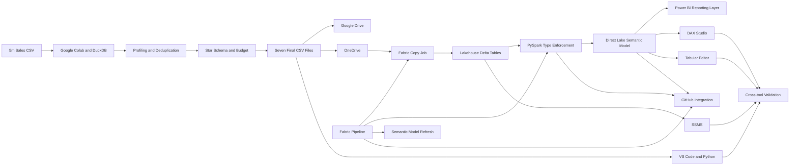
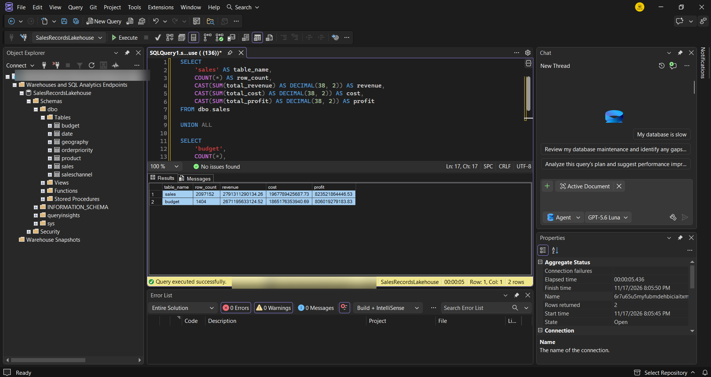
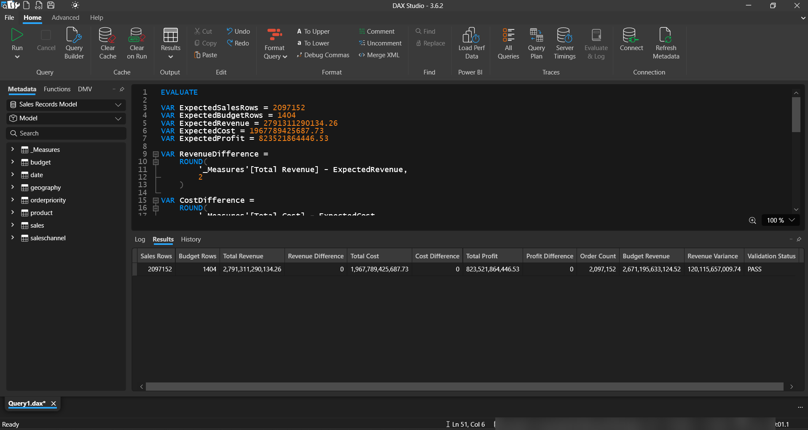
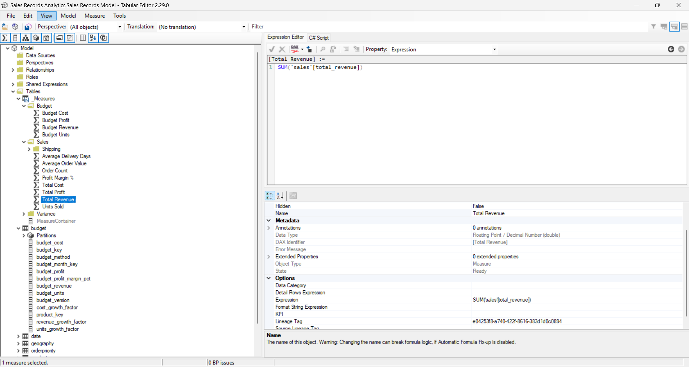
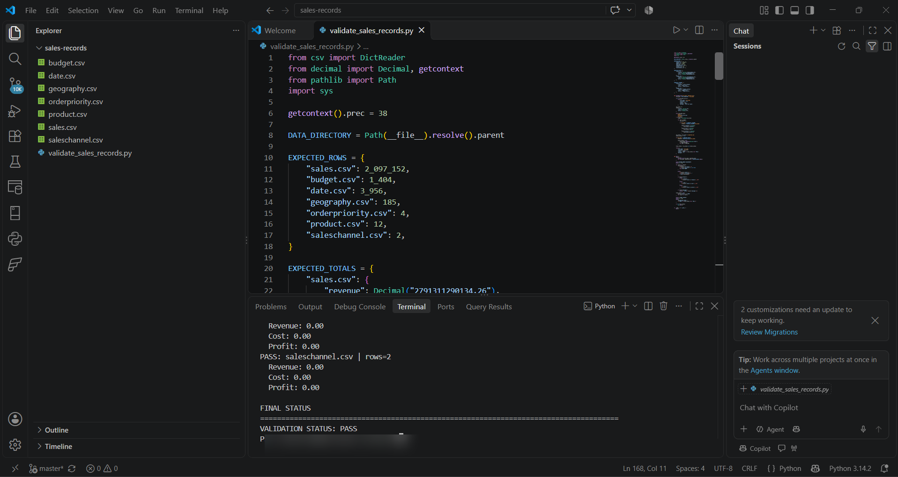

# Sales Records Fabric Analytics

[](https://www.microsoft.com/microsoft-fabric)
[](https://powerbi.microsoft.com/)
[](https://www.python.org/)
[](https://learn.microsoft.com/fabric/data-engineering/lakehouse-sql-analytics-endpoint)
[](https://learn.microsoft.com/dax/)
[](LICENSE)

An end-to-end Microsoft Fabric data engineering and analytics project that transforms a synthetic five-million-row sales dataset into a validated dimensional model with automated ingestion, Delta Lake storage, Direct Lake semantic modeling, product-level budgeting, and independent reconciliation across Python, SQL, and DAX.

The project demonstrates an effective development workflow combining Google Colab, DuckDB, OneDrive, Microsoft Fabric, Power BI, DAX Studio, Tabular Editor, SQL Server Management Studio, Visual Studio Code, and GitHub.

---

## Table of contents

- [Project overview](#project-overview)
- [Business applications](#business-applications)
- [Source dataset](#source-dataset)
- [Data-quality discovery](#data-quality-discovery)
- [Google Colab transformation](#google-colab-transformation)
- [Dimensional model](#dimensional-model)
- [Budget model](#budget-model)
- [Solution architecture](#solution-architecture)
- [Microsoft Fabric implementation](#microsoft-fabric-implementation)
- [Direct Lake semantic model](#direct-lake-semantic-model)
- [Developer-tool integration](#developer-tool-integration)
- [Data-quality and validation strategy](#data-quality-and-validation-strategy)
- [Verified results](#verified-results)
- [GitHub integration](#github-integration)
- [Repository structure](#repository-structure)
- [Reproduction workflow](#reproduction-workflow)
- [Operational considerations](#operational-considerations)
- [Skills demonstrated](#skills-demonstrated)
- [Limitations](#limitations)
- [License](#license)

---

## Project overview

The original source was a single flat CSV file containing **5,000,000 synthetic sales records**. The project converts that file into a governed analytical solution containing:

- a deduplicated sales fact table,
- a product-month budget fact table,
- five shared dimensions,
- a Microsoft Fabric Lakehouse,
- typed Delta tables,
- an automated Fabric pipeline,
- a Direct Lake semantic model,
- reusable DAX measures,
- independent Python, SQL, and DAX validation,
- GitHub-integrated Fabric definitions.

The completed solution supports repeatable ingestion, schema enforcement, model refresh, Actual versus Budget reporting, profitability analysis, delivery-time analysis, and reproducible validation.

---

## Business applications

### Executive performance monitoring

- Total revenue, cost, and profit
- Profit margin
- Units sold and order count
- Average order value
- Budget attainment

### Actual versus Budget analysis

- Revenue and profit variance
- Revenue and profit variance percentage
- Revenue and profit budget attainment
- Monthly product-level comparison

### Product and geographic analysis

- Revenue and profitability by product
- Country and regional performance
- Product contribution to total profit
- Geographic market contribution

### Channel and delivery analysis

- Online versus offline performance
- Revenue by order date and ship date
- Average delivery duration
- Delivery duration by product, country, and priority

---

## Source dataset

The project uses the synthetic **5m Sales Records** dataset:

[Sales Records sample dataset download page](https://excelbianalytics.com/downloads-18-sample-csv-files-data-sets-for-testing-sales/)

The original source contains 14 columns:

| Source column | Description |
|---|---|
| Region | Geographic sales region |
| Country | Country in which the order was placed |
| Item Type | Product type |
| Sales Channel | Online or offline channel |
| Order Priority | Critical, High, Medium, or Low |
| Order Date | Date on which the order was placed |
| Order ID | Source order identifier |
| Ship Date | Date on which the order was shipped |
| Units Sold | Number of units sold |
| Unit Price | Revenue per unit |
| Unit Cost | Cost per unit |
| Total Revenue | Units Sold multiplied by Unit Price |
| Total Cost | Units Sold multiplied by Unit Cost |
| Total Profit | Total Revenue minus Total Cost |

> The source is synthetic and intended for technical testing, data engineering, and analytics practice. Large source and output files are intentionally excluded from this repository.

---

## Data-quality discovery

Initial profiling identified a critical duplicate-data issue.

| Validation check | Result |
|---|---:|
| Original source rows | 5,000,000 |
| Distinct complete rows | 2,097,152 |
| Exact duplicate rows | 2,902,848 |
| Conflicting duplicate Order IDs | 0 |
| Maximum occurrences of one Order ID | 3 |

The duplicate rows were identical across all 14 source columns. Keeping them would have overstated revenue, cost, profit, units, orders, and every downstream performance metric.

The raw source was preserved unchanged. The analytical model was built from **2,097,152 unique transactions**.

```text
5,000,000 original rows
- 2,902,848 exact duplicate rows
= 2,097,152 valid analytical rows
```

---

## Google Colab transformation

Google Colab and DuckDB were used to profile, clean, transform, validate, and export the data efficiently without loading the full CSV into a pandas DataFrame.

### Transformation workflow

1. Connect Colab to Google Drive.
2. Validate the expected 14-column source schema.
3. Profile all five million rows.
4. Test required values and date sequences.
5. Reconcile revenue, cost, and profit formulas.
6. Analyze repeated Order IDs.
7. Separate exact duplicates from conflicting records.
8. Remove only exact duplicate rows.
9. Standardize names to `snake_case`.
10. Apply explicit numeric and date types.
11. Create surrogate dimension keys.
12. Build five dimensions and the sales fact table.
13. Generate a product-month budget.
14. Validate keys, relationships, and financial totals.
15. Export seven final analytical tables.

### Added analytical attributes

| Column | Purpose |
|---|---|
| `delivery_days` | Days between order and shipment |
| `unit_margin` | Unit price minus unit cost |
| `profit_margin_pct` | Profit divided by revenue |

---

## Dimensional model

The final model contains two fact tables and five shared dimensions.

### `sales` fact table

**Grain:** one row per unique sales order.

**Final row count:** `2,097,152`

Main fields include transaction identifiers, dimension keys, units, prices, costs, revenue, profit, delivery duration, unit margin, and profit margin.

### `budget` fact table

**Grain:** one product per month.

**Final row count:** `1,404`

The budget retains a higher grain than detailed sales transactions, enabling realistic Actual versus Budget analysis without introducing false geographic or channel precision.

### Dimensions

| Dimension | Purpose | Rows |
|---|---|---:|
| `date` | Continuous order and shipping calendar | 3,956 |
| `product` | Product types and reporting names | 12 |
| `geography` | Country and region combinations | 185 |
| `saleschannel` | Online and offline channels | 2 |
| `orderpriority` | Critical, High, Medium, and Low priorities | 4 |

### Star schema



The model uses one-to-many relationships and single-direction filtering from dimensions to facts. Order Date is active; Ship Date is inactive and activated only by dedicated DAX measures.

---

## Budget model

The source did not include budget data, so the project adds a synthetic but controlled budget at **product-month** grain.

| Budget metric | Growth factor |
|---|---:|
| Units | 1.03 |
| Revenue | 1.05 |
| Cost | 1.04 |
| Profit | Budget Revenue minus Budget Cost |

Budget rows are generated from prior-year product-month actuals. Shared Date and Product dimensions allow Actual and Budget to be compared without changing the native grain of either fact table.

---

## Solution architecture



---

## Microsoft Fabric implementation

### Fabric workspace

The `Sales Records Analytics` workspace contains:

- `CopyJob_1`
- `Fix_Sales_Records_Data_Types`
- `Load_Sales_Records`
- `Sales Records Model`
- `SalesRecordsLakehouse`
- Lakehouse SQL Analytics Endpoint


### Automated pipeline

The pipeline executes three dependent activities:

```text
Copy Job
   ↓
Data-Type Enforcement Notebook
   ↓
Semantic Model Refresh
```

The Copy Job reads seven CSV files from OneDrive through the SharePoint Folder connector. Each file maps to a separate Lakehouse table.

The destination configuration is:

```text
Full copy + Overwrite
```

This prevents duplicate appends during repeated runs. The notebook runs only after a successful copy, and the semantic model refresh runs only after successful schema enforcement.


### Data-type enforcement

CSV does not retain physical schema metadata. The ingestion step therefore loads values as strings. The `Fix_Sales_Records_Data_Types` notebook converts the Delta tables after every copy.

| Column category | Target type |
|---|---|
| Fact keys | `BIGINT` |
| Dimension keys | `INT` |
| Dates | `DATE` |
| Financial values | `DECIMAL(18,2)` |
| Percentages | `DECIMAL(18,4)` |
| Budget growth factors | `DECIMAL(6,4)` |
| Weekend flag | `BOOLEAN` |
| Descriptive attributes | `STRING` |

The notebook also validates all expected row counts and stops the pipeline when a critical test fails.

---

## Direct Lake semantic model

The semantic model uses Direct Lake over Delta tables in OneLake.

The model includes:

- two fact tables,
- five dimensions,
- seven active relationships,
- one inactive ship-date relationship,
- a marked Date table,
- chronological sort rules,
- a dedicated `_Measures` table,
- Sales, Budget, Shipping, and Variance display folders.

### Date-table configuration

The Date table contains date, year, quarter, month, week, weekday, weekend, month-start, and month-end attributes.

Configured sorting includes:

- month name by month number,
- abbreviated month by month number,
- quarter name by quarter number,
- weekday name by weekday number,
- year-month by month-start date.

### Measures

**Sales:** Total Revenue, Total Cost, Total Profit, Profit Margin %, Units Sold, Order Count, Average Order Value, Average Delivery Days.

**Shipping:** Revenue by Ship Date using `USERELATIONSHIP`.

**Budget:** Budget Revenue, Budget Cost, Budget Profit, Budget Units.

**Variance:** Revenue Variance, Revenue Variance %, Profit Variance, Profit Variance %, Revenue Budget Attainment %, Profit Budget Attainment %.

---

## Developer-tool integration

The project deliberately uses specialist tools for their strongest workloads.

### SQL Server Management Studio

SSMS connects to the Lakehouse SQL Analytics Endpoint and validates row counts, schemas, financial totals, and SQL accessibility.



### DAX Studio

DAX Studio connects through the XMLA endpoint and validates measures, filters, Actual versus Budget results, and cross-engine reconciliation.



### Tabular Editor

Tabular Editor is used to inspect model metadata, measures, relationships, display folders, Date configuration, and Best Practice Analyzer findings.



### Visual Studio Code and Python

Visual Studio Code hosts an independent Python validation script using `csv.DictReader`, `decimal.Decimal`, and explicit expected values. The script validates every file, all row counts, and sales and budget financial totals.



---

## Data-quality and validation strategy

Data quality is a design requirement, not a final reporting check.

### Source controls

- Expected schema and row count
- Required-field checks
- Duplicate Order ID analysis
- Exact duplicate detection
- Conflicting transaction detection

### Business-rule controls

- Ship Date is not earlier than Order Date
- Units Sold is positive
- Price and cost values are nonnegative
- Revenue equals Units Sold multiplied by Unit Price
- Cost equals Units Sold multiplied by Unit Cost
- Profit equals Revenue minus Cost

### Model controls

- Unique primary and surrogate keys
- Non-null foreign keys
- Zero orphan dimension references
- Unique Order IDs after deduplication
- Unique product-month budget grain
- Reconciled source and destination row counts

### Cross-tool controls

| Layer | Tool | Purpose |
|---|---|---|
| Source engineering | Google Colab and DuckDB | Profiling, transformation, and reconciliation |
| Lakehouse schema | Fabric Notebook and PySpark | Type enforcement and row validation |
| SQL endpoint | SSMS and T-SQL | Aggregates and table counts |
| Semantic model | DAX Query View and DAX Studio | Measures, filters, and relationships |
| Local package | Visual Studio Code and Python | Independent CSV validation |
| Model metadata | Tabular Editor | DAX inspection and BPA |

The governing rule is:

```text
Do not continue when a critical validation returns FAIL.
```

---

## Verified results

### Sales

| Metric | Verified result |
|---|---:|
| Rows | 2,097,152 |
| Distinct orders | 2,097,152 |
| Revenue | 2,791,311,290,134.26 |
| Cost | 1,967,789,425,687.73 |
| Profit | 823,521,864,446.53 |
| Profit margin | 29.50% |
| Units sold | 10,486,803,584 |
| Average order value | 1,331,000.94 |
| Average delivery time | 25.00 days |

### Budget

| Metric | Verified result |
|---|---:|
| Rows | 1,404 |
| Revenue | 2,671,195,633,124.52 |
| Cost | 1,865,176,353,940.69 |
| Profit | 806,019,279,183.83 |
| Units | 9,844,570,623 |

### Actual versus Budget

| Metric | Verified result |
|---|---:|
| Revenue variance | 120,115,657,009.74 |
| Revenue variance % | 4.50% |
| Revenue budget attainment | 104.50% |
| Profit variance | 17,502,585,262.70 |
| Profit variance % | 2.17% |
| Profit budget attainment | 102.17% |

### Validation status

```text
Google Colab                  PASS
DuckDB                        PASS
Fabric Copy Job               PASS
Fabric Notebook               PASS
Fabric SQL Analytics Endpoint PASS
Semantic Model Refresh        PASS
DAX Query View                PASS
DAX Studio                    PASS
SQL Server Management Studio  PASS
Visual Studio Code / Python   PASS
Tabular Editor BPA            PASS
```

---

## GitHub integration

The Fabric workspace is connected to this repository and synchronized with the `main` branch.

The repository stores supported definitions for:

- Copy Job,
- Data Pipeline,
- Notebook,
- Lakehouse,
- Semantic Model.

The repository intentionally excludes OneLake data, large CSV files, credentials, personal access tokens, private connection strings, local user paths, pipeline history, and private endpoint details.

---

## Repository structure

```text
.
├── CopyJob_1.CopyJob/
├── Fix_Sales_Records_Data_Types.Notebook/
├── Load_Sales_Records.DataPipeline/
├── Sales Records Model.SemanticModel/
├── SalesRecordsLakehouse.Lakehouse/
├── docs/
│   └── images/
│       ├── 01_fabric_workspace.png
│       ├── 02_fabric_pipeline.png
│       ├── 03_ssms_sql_endpoint.png
│       ├── 04_dax_studio.png
│       ├── 05_tabular_editor.png
│       └── 06_visual_studio_code.png
├── LICENSE
└── README.md
```

---

## Reproduction workflow

1. Download the synthetic 5m Sales Records dataset.
2. Store the source in Google Drive.
3. Connect Google Colab to Google Drive.
4. Profile and deduplicate the data with DuckDB.
5. Build the fact and dimension tables.
6. Generate the product-month budget.
7. Validate keys, relationships, formulas, and totals.
8. Export seven analytical CSV files.
9. Upload the final files to the OneDrive `sales-records` folder.
10. Create the Fabric workspace and Lakehouse.
11. Configure the Copy Job with `Full copy + Overwrite`.
12. Add the type-enforcement notebook.
13. Add semantic-model refresh to the pipeline.
14. Create the Direct Lake semantic model.
15. Configure the Date table, relationships, and DAX measures.
16. Run SQL, Python, and DAX reconciliation tests.
17. Connect DAX Studio, Tabular Editor, SSMS, and VS Code.
18. Connect Fabric to GitHub and commit supported definitions.

---

## Operational considerations

The source remains CSV-based for portability. Because CSV does not retain physical types, the pipeline must preserve this sequence:

```text
Copy Job → Type-Enforcement Notebook → Semantic Model Refresh
```

Running only the Copy Job could replace typed Delta columns with strings and break aggregations, relationships, DAX calculations, or downstream reports.

The pipeline dependencies prevent invalid downstream refreshes when an upstream activity fails.

---

## Skills demonstrated

- Microsoft Fabric, OneLake, Lakehouse, and Delta Lake
- Data Factory Pipeline and Copy Job
- Fabric Notebook and PySpark
- Direct Lake and Power BI semantic modeling
- DAX and TMDL
- SQL and SQL Analytics Endpoint
- Python, DuckDB, and Google Colab
- Google Drive, OneDrive, and SharePoint Folder connector
- DAX Studio, Tabular Editor, and Best Practice Analyzer
- SQL Server Management Studio and Visual Studio Code
- XMLA endpoint integration
- GitHub integration and technical documentation
- Dimensional modeling and Actual versus Budget analysis
- Data-quality engineering and cross-engine reconciliation

---

## Limitations

- The source is synthetic and does not represent real commercial activity.
- Budget values use predefined prior-year growth assumptions.
- The source has no customer, physical-store, or product-SKU detail.
- Budget is maintained only at product-month granularity.
- Geography and channel budget allocation are outside the current scope.
- CSV files do not retain physical data types.
- The project was developed with Microsoft Fabric Trial capacity.
- Git stores supported definitions, not OneLake data.
- Credentials and private connections must be recreated after deployment.
- A final Power BI report can be added as a separate presentation layer.

---

## License

This project is licensed under the [MIT License](LICENSE).
