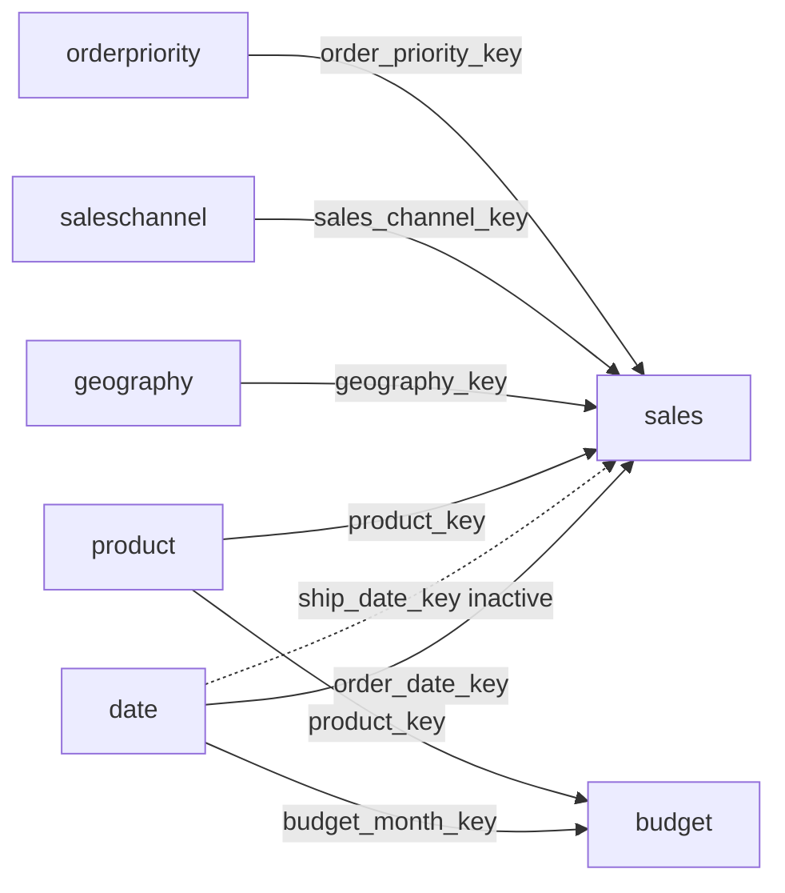
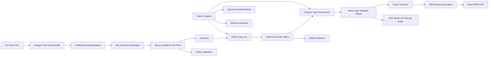
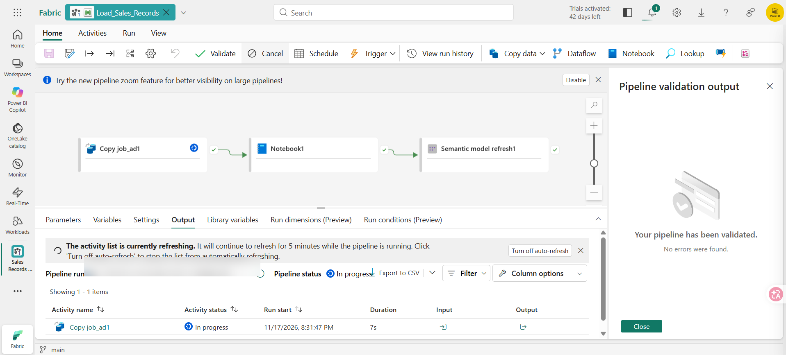

# Sales Records Fabric Analytics

[](https://www.microsoft.com/microsoft-fabric)
[](https://powerbi.microsoft.com/)
[](https://www.python.org/)
[](https://learn.microsoft.com/fabric/data-engineering/lakehouse-sql-analytics-endpoint)
[](https://learn.microsoft.com/dax/)
[](https://learn.microsoft.com/power-bi/developer/projects/projects-report)
[](LICENSE)

An end-to-end Microsoft Fabric data engineering and analytics project that transforms a synthetic five-million-row sales dataset into a validated dimensional model with automated ingestion, Delta Lake storage, Direct Lake semantic modeling, product-level budgeting, independent reconciliation, and a programmatically engineered Power BI reporting layer.

The solution combines Google Colab, DuckDB, OneDrive, Microsoft Fabric, Power BI, PBIR, Fabric REST APIs, Python, DAX Studio, Tabular Editor, SQL Server Management Studio, Visual Studio Code, and GitHub.


> [!NOTE]
> The source data is synthetic and intended for technical testing, data engineering, semantic modeling, report engineering, and analytics practice. The project does not represent real commercial activity.

---

## Table of contents

- [Project overview](#project-overview)
- [Business applications](#business-applications)
- [Global Sales Performance Dashboard](#global-sales-performance-dashboard)
- [Source dataset and data quality](#source-dataset-and-data-quality)
- [Dimensional and budget model](#dimensional-and-budget-model)
- [Solution architecture](#solution-architecture)
- [Microsoft Fabric implementation](#microsoft-fabric-implementation)
- [Direct Lake semantic model](#direct-lake-semantic-model)
- [PBIR report automation](#pbir-report-automation)
- [Validation strategy](#validation-strategy)
- [Verified results](#verified-results)
- [Repository structure](#repository-structure)
- [Reproduction workflow](#reproduction-workflow)
- [Operational considerations](#operational-considerations)
- [Skills demonstrated](#skills-demonstrated)
- [Limitations](#limitations)
- [License](#license)

---

## Project overview

The original source was a single flat CSV file containing **5,000,000 synthetic sales records**. The project converts that file into a governed analytical solution containing:

- a deduplicated sales fact table,
- a product-month budget fact table,
- five shared dimensions,
- a Microsoft Fabric Lakehouse,
- typed Delta tables,
- an automated Fabric pipeline,
- a Direct Lake semantic model,
- reusable DAX measures,
- a five-page Power BI report,
- PBIR report-definition automation,
- independent Python, SQL, and DAX validation,
- GitHub-integrated Fabric definitions.

The analytical layer contains **2,097,152 unique transactions** after removal of **2,902,848 exact duplicate rows**.

## Business applications

### Executive performance monitoring

- Total revenue, profit, margin, units, and orders
- Monthly Actual versus Budget trend
- Product and regional contribution
- Revenue budget attainment

### Actual versus Budget analysis

- Revenue and profit variance
- Variance percentages and attainment
- Monthly and product-level comparison
- Identification of incomplete reporting periods

### Product and geographic analysis

- Top products by revenue, profit, and margin
- Regional revenue contribution
- Product profitability and volume
- Country and market analysis

### Channel, order, and delivery analysis

- Online versus offline performance
- Order-priority analysis
- Revenue by order date and ship date
- Average delivery duration

---

## Global Sales Performance Dashboard

`Global Sales Performance Dashboard` is connected to `Sales Records Model` through Direct Lake and contains five analytical pages:

1. **Executive Overview**
2. **Budget Performance**
3. **Product Performance**
4. **Markets and Channels**
5. **Orders and Delivery**

### Executive Overview

The portfolio-ready Executive Overview includes:

- Year dropdown slicer
- Revenue
- Profit
- Profit Margin
- Revenue versus Budget attainment
- Orders
- Revenue versus Budget monthly trend
- Top 5 Products by Revenue
- Revenue by Region
- Top 5 Products by Margin
- Top 5 Products by Profit

The displayed 2019 selection demonstrates:

| KPI | Value |
|---|---:|
| Revenue | 260.84bn |
| Profit | 76.96bn |
| Profit Margin | 29.50% |
| Revenue vs Budget | 95.24% |
| Orders | 196K |


The final design uses a fixed `1280 × 720` canvas, a consistent 12-pixel grid, aligned KPI cards, a dominant Actual-versus-Budget trend, and focused Top 5 rankings without unnecessary scrollbars.

---

## Source dataset and data quality

The project uses the synthetic **5m Sales Records** dataset from [Excel BI Analytics](https://excelbianalytics.com/downloads-18-sample-csv-files-data-sets-for-testing-sales/).

### Source discovery

| Validation check | Result |
|---|---:|
| Original source rows | 5,000,000 |
| Distinct complete rows | 2,097,152 |
| Exact duplicate rows | 2,902,848 |
| Conflicting duplicate Order IDs | 0 |
| Maximum occurrences of one Order ID | 3 |

The duplicate rows were identical across all 14 source columns. The raw source was preserved unchanged, while the analytical model was built from the unique transactions.

```text
5,000,000 original rows
- 2,902,848 exact duplicate rows
= 2,097,152 valid analytical rows
```

### Transformation workflow

1. Validate the source schema.
2. Profile all five million rows with DuckDB.
3. Reconcile revenue, cost, and profit formulas.
4. Separate exact duplicates from conflicting records.
5. Remove only exact duplicate rows.
6. Standardize names to `snake_case`.
7. Apply explicit numeric and date types.
8. Create surrogate keys.
9. Build facts and dimensions.
10. Generate the product-month budget.
11. Validate keys, relationships, and totals.
12. Export seven analytical tables.

---

## Dimensional and budget model

The model contains two fact tables and five shared dimensions.

| Table | Grain | Rows |
|---|---|---:|
| `sales` | One row per unique sales order | 2,097,152 |
| `budget` | One product per month | 1,404 |
| `date` | One row per calendar date | 3,956 |
| `product` | One row per product type | 12 |
| `geography` | One row per country-region combination | 185 |
| `saleschannel` | One row per sales channel | 2 |
| `orderpriority` | One row per priority | 4 |



### Budget assumptions

| Budget metric | Growth factor |
|---|---:|
| Units | 1.03 |
| Revenue | 1.05 |
| Cost | 1.04 |
| Profit | Budget Revenue minus Budget Cost |

Budget rows are generated from prior-year product-month actuals. Budget comparisons begin in 2011 because 2010 is the prior-year baseline. September 2020 is an incomplete month and is excluded from the executive trend where appropriate.

---

## Solution architecture



---

## Microsoft Fabric implementation

The `Sales Records Analytics` workspace contains:

- `CopyJob_1`
- `Fix_Sales_Records_Data_Types`
- `Load_Sales_Records`
- `Sales Records Model`
- `SalesRecordsLakehouse`
- `Global Sales Performance Dashboard`
- `GlobalSalesReport_Designer`


### Automated pipeline

```text
Copy Job
   ↓
Data-Type Enforcement Notebook
   ↓
Semantic Model Refresh
```

The Copy Job uses `Full copy + Overwrite`, preventing duplicate appends during repeated runs. The type-enforcement notebook executes only after a successful copy, and semantic-model refresh executes only after successful schema validation.



### Data-type enforcement

| Column category | Target type |
|---|---|
| Fact keys | `BIGINT` |
| Dimension keys | `INT` |
| Dates | `DATE` |
| Financial values | `DECIMAL(18,2)` |
| Percentages | `DECIMAL(18,4)` |
| Budget growth factors | `DECIMAL(6,4)` |
| Weekend flag | `BOOLEAN` |
| Descriptive attributes | `STRING` |

---

## Direct Lake semantic model

The semantic model uses Direct Lake over Delta tables in OneLake and includes:

- two fact tables,
- five dimensions,
- seven active relationships,
- one inactive ship-date relationship,
- a marked Date table,
- chronological sort rules,
- a dedicated `_Measures` table,
- Sales, Budget, Shipping, and Variance display folders.

Core measures include:

- Total Revenue
- Total Cost
- Total Profit
- Profit Margin %
- Units Sold
- Order Count
- Average Order Value
- Average Delivery Days
- Revenue by Ship Date
- Budget Revenue, Cost, Profit, and Units
- Revenue and Profit Variance
- Revenue and Profit Budget Attainment %

---

## PBIR report automation

`GlobalSalesReport_Designer` uses Python, PBIR JSON, and Microsoft Fabric REST APIs to inspect, validate, create, and update the report definition.

```text
Global Sales Performance Dashboard
        |
        v
Get Report Definition
        |
        v
Decode InlineBase64 PBIR parts
        |
        v
Inspect pages and visual.json definitions
        |
        v
Create validated in-memory changes
        |
        v
Update the complete report definition
        |
        v
Poll the Fabric long-running operation
        |
        v
Verify the stored report state
```

The notebook uses:

```text
POST /v1/workspaces/{workspaceId}/reports/{reportId}/getDefinition
POST /v1/workspaces/{workspaceId}/reports/{reportId}/updateDefinition
GET  /v1/operations/{operationId}
GET  /v1/operations/{operationId}/result
```

Authentication is obtained without hardcoded credentials:

```python
notebookutils.credentials.getToken("pbi")
```

### Automated report-engineering capabilities

- report and page inventory
- semantic-model binding validation
- exact visual positioning on a 12-pixel grid
- structural field and measure assignment
- dropdown slicer configuration
- Actual-versus-Budget line chart generation
- Top 5 product rankings
- percentage-display correction
- incomplete-period exclusion
- validation of changed PBIR paths
- long-running operation polling
- preparation of `rollback_request_body`

The report-design notebook does not require a default Lakehouse because the notebook operates on the Power BI report definition.

---

## Validation strategy

### Source controls

- expected schema and row count
- required-field checks
- duplicate Order ID analysis
- exact duplicate detection
- conflicting transaction detection

### Business-rule controls

- Ship Date is not earlier than Order Date
- Units Sold is positive
- price and cost values are nonnegative
- Revenue equals Units Sold multiplied by Unit Price
- Cost equals Units Sold multiplied by Unit Cost
- Profit equals Revenue minus Cost

### Model and report controls

- unique primary and surrogate keys
- non-null foreign keys
- zero orphan dimension references
- unique product-month budget grain
- reconciled source and destination row counts
- expected semantic fields and measures
- expected PBIR visual IDs and paths
- approved report positions and dimensions
- preserved semantic-model binding
- restricted update scope before deployment

```text
Do not continue when a critical validation returns FAIL.
```

---

## Verified results

### Sales

| Metric | Verified result |
|---|---:|
| Rows | 2,097,152 |
| Distinct orders | 2,097,152 |
| Revenue | 2,791,311,290,134.26 |
| Cost | 1,967,789,425,687.73 |
| Profit | 823,521,864,446.53 |
| Profit margin | 29.50% |
| Units sold | 10,486,803,584 |
| Average order value | 1,331,000.94 |
| Average delivery time | 25.00 days |

### Budget

| Metric | Verified result |
|---|---:|
| Rows | 1,404 |
| Revenue | 2,671,195,633,124.52 |
| Cost | 1,865,176,353,940.69 |
| Profit | 806,019,279,183.83 |
| Units | 9,844,570,623 |

### Actual versus Budget

| Metric | Verified result |
|---|---:|
| Revenue variance | 120,115,657,009.74 |
| Revenue variance % | 4.50% |
| Revenue budget attainment | 104.50% |
| Profit variance | 17,502,585,262.70 |
| Profit variance % | 2.17% |
| Profit budget attainment | 102.17% |

### Cross-tool validation

```text
Google Colab                  PASS
DuckDB                        PASS
Fabric Copy Job               PASS
Fabric Notebook               PASS
Fabric SQL Analytics Endpoint PASS
Semantic Model Refresh        PASS
DAX Query View                PASS
DAX Studio                    PASS
SQL Server Management Studio  PASS
Visual Studio Code / Python   PASS
Tabular Editor BPA            PASS
PBIR Report Validation        PASS
Fabric REST API Deployment    PASS
```

---

## Repository structure

```text
.
├── CopyJob_1.CopyJob/
├── Fix_Sales_Records_Data_Types.Notebook/
├── Global Sales Performance Dashboard.Report/
├── GlobalSalesReport_Designer.Notebook/
├── Load_Sales_Records.DataPipeline/
├── Sales Records Model.SemanticModel/
├── SalesRecordsLakehouse.Lakehouse/
├── docs/
│   └── images/
│       ├── 01_fabric_workspace.png
│       ├── 02_fabric_pipeline.png
│       ├── 03_ssms_sql_endpoint.png
│       ├── 04_dax_studio.png
│       ├── 05_tabular_editor.png
│       ├── 06_visual_studio_code.png
│       └── global-sales-performance-dashboard.png
├── LICENSE
└── README.md
```

---

## Reproduction workflow

1. Download the synthetic 5m Sales Records dataset.
2. Profile and deduplicate the data with Google Colab and DuckDB.
3. Build the facts and dimensions.
4. Generate the product-month budget.
5. Validate keys, relationships, formulas, and totals.
6. Export seven analytical CSV files.
7. Upload the files to the OneDrive `sales-records` folder.
8. Create the Fabric workspace and Lakehouse.
9. Configure the Copy Job with `Full copy + Overwrite`.
10. Run the type-enforcement notebook.
11. Refresh the Direct Lake semantic model.
12. Validate SQL, Python, and DAX results.
13. Create `Global Sales Performance Dashboard` from `Sales Records Model`.
14. Run `GlobalSalesReport_Designer` for validated PBIR deployment.
15. Verify Executive Overview values, filters, rankings, and Actual-versus-Budget trend.
16. Commit supported Fabric definitions through native Git integration.

---

## Operational considerations

The source remains CSV-based for portability. Because CSV does not preserve physical types, the pipeline must maintain this sequence:

```text
Copy Job → Type-Enforcement Notebook → Semantic Model Refresh
```

The PBIR notebook must validate the current report schema, visual IDs, paths, and semantic-model binding before applying updates. The in-memory rollback payload remains available only during the active notebook session unless explicitly persisted.

---

## Skills demonstrated

- Microsoft Fabric, OneLake, Lakehouse, and Delta Lake
- Data Factory Pipeline and Copy Job
- Fabric Notebook and PySpark
- Direct Lake and Power BI semantic modeling
- DAX and TMDL
- Power BI Project format and PBIR JSON
- Microsoft Fabric REST APIs
- Python report-definition automation
- validation-driven report deployment
- SQL and SQL Analytics Endpoint
- Python, DuckDB, and Google Colab
- DAX Studio, Tabular Editor, and Best Practice Analyzer
- SQL Server Management Studio and Visual Studio Code
- XMLA endpoint integration
- GitHub integration and technical documentation
- dimensional modeling and Actual-versus-Budget analysis
- data-quality engineering and cross-engine reconciliation

---

## Limitations

- The source is synthetic and does not represent real commercial activity.
- Budget values use predefined prior-year growth assumptions.
- Budget is maintained only at product-month granularity.
- Geography and channel budget allocation are outside the current scope.
- September 2020 is an incomplete reporting month.
- CSV files do not preserve physical data types.
- The project was developed with Microsoft Fabric Trial capacity.
- Git stores supported definitions, not OneLake data.
- Credentials and private connections must be recreated after deployment.
- PBIR visual structures can change between Power BI schema versions.
- Deployment pipelines and automated CI/CD validation are outside the current scope.

---

## License

This project is licensed under the [MIT License](LICENSE).
