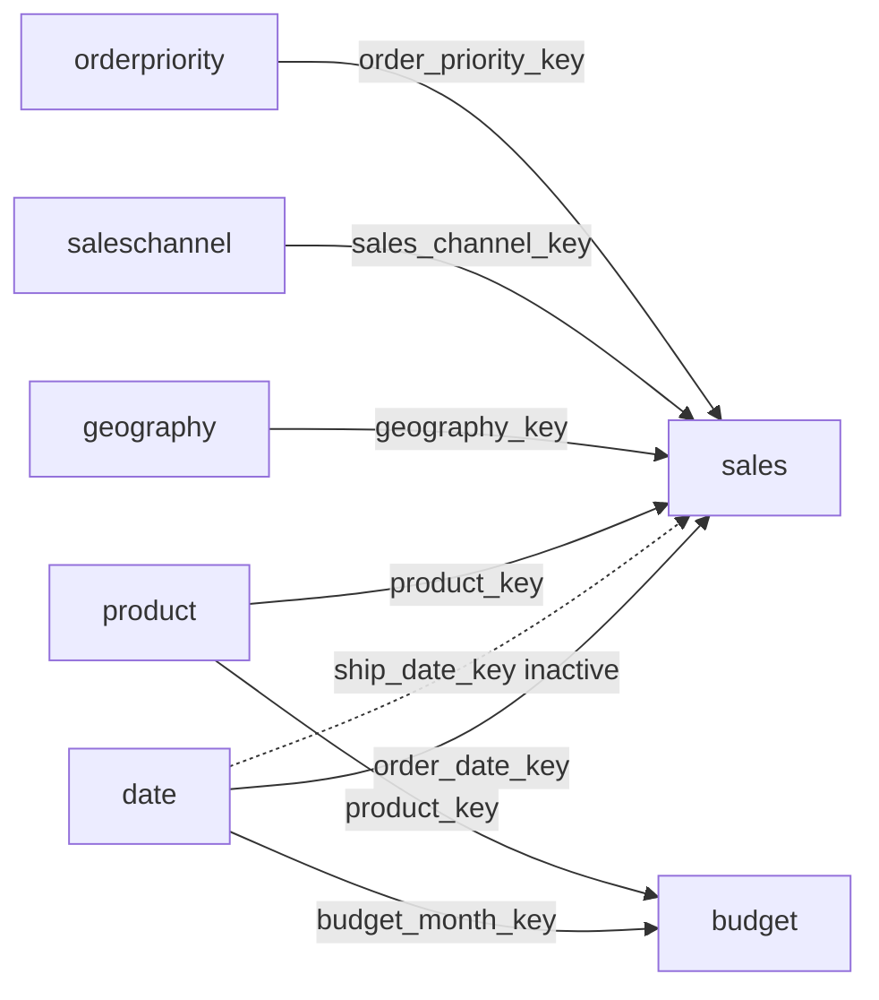
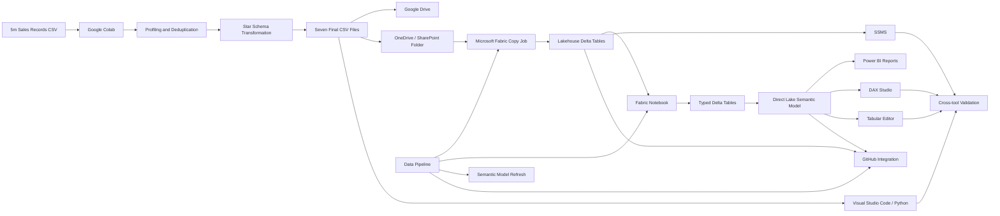

# Sales Records Fabric Analytics

An end-to-end data engineering and analytics portfolio project built with Microsoft Fabric, Google Colab, OneDrive, Power BI, DAX Studio, Tabular Editor, SQL Server Management Studio, Visual Studio Code, and GitHub.

The solution transforms a synthetic five-million-row sales dataset into a validated star schema with sales and budget fact tables, reusable dimensions, automated ingestion, type enforcement, a Direct Lake semantic model, and multi-tool reconciliation tests.

## Project overview

The original source was a single flat CSV file containing 5,000,000 synthetic sales records.

The project converts that file into a governed analytical solution that supports:

- sales and profitability analysis,
- Actual versus Budget reporting,
- product and monthly budget comparisons,
- order-date and ship-date analysis,
- repeatable ingestion from OneDrive,
- automated data-type correction,
- semantic-model refresh,
- validation across Python, SQL, DAX, and external development tools,
- Git-based version control for supported Microsoft Fabric artifacts.

## Business objectives

The project addresses the following analytical and engineering requirements:

- Convert a flat sales file into a dimensional star schema.
- Detect and remove exact duplicate transactions.
- Preserve all valid financial values and transaction keys.
- Extend the source with delivery and profitability attributes.
- Generate a monthly product-level budget.
- Compare Actual and Budget values using shared dimensions.
- Automate ingestion and semantic-model refresh in Microsoft Fabric.
- Validate the same results independently with Python, SQL, and DAX.
- Manage supported Fabric definitions through GitHub integration.
- Make the final solution reproducible and suitable for portfolio review.

## Source dataset

The source is the synthetic **5m Sales Records** dataset:

[Sales Records sample datasets](https://excelbianalytics.com/downloads-18-sample-csv-files-data-sets-for-testing-sales/)

The original flat file contains the following attributes:

- Region
- Country
- Item Type
- Sales Channel
- Order Priority
- Order Date
- Order ID
- Ship Date
- Units Sold
- Unit Price
- Unit Cost
- Total Revenue
- Total Cost
- Total Profit

The source data is synthetic and intended for technical testing and analytics practice.

## Data-quality discovery

Initial profiling identified a major source-quality issue.

| Check | Result |
|---|---:|
| Original source rows | 5,000,000 |
| Distinct complete rows | 2,097,152 |
| Exact duplicate rows | 2,902,848 |
| Conflicting duplicate Order IDs | 0 |
| Maximum occurrences of one Order ID | 3 |

The 2,902,848 duplicate rows were exact copies across all source columns.

Keeping those rows would have overstated:

- revenue,
- cost,
- profit,
- units sold,
- order counts,
- product performance.

The raw source was preserved unchanged, while the analytical model was built from the 2,097,152 unique transactions.

## Data transformation

Google Colab and DuckDB were used to profile, clean, transform, validate, and export the source data.

The transformation process included:

1. Loading and profiling the five-million-row CSV.
2. Detecting exact duplicates and repeated Order IDs.
3. Removing only exact duplicate rows.
4. Converting column names to `snake_case`.
5. Enforcing appropriate numeric and date types.
6. Validating financial formulas.
7. Creating dimension surrogate keys.
8. Building the sales fact table.
9. Generating a product-month budget.
10. Exporting seven final analytical tables.

### Added analytical attributes

The sales fact table was extended with:

- `delivery_days`
- `unit_margin`
- `profit_margin_pct`

The project also introduced technical surrogate keys for all facts and dimensions.

## Dimensional model

The final model contains two fact tables and five shared dimensions.

### Fact tables

#### `sales`

Grain:

> One row per unique sales order.

Key metrics:

- units sold,
- unit price,
- unit cost,
- total revenue,
- total cost,
- total profit,
- delivery days,
- unit margin,
- profit margin percentage.

Final row count:

```text
2,097,152
```

#### `budget`

Grain:

> One product per month.

The budget is intentionally maintained at a higher level of granularity than individual sales transactions.

Budget values were generated from prior-year product-month actuals:

| Metric | Growth factor |
|---|---:|
| Budget units | 1.03 |
| Budget revenue | 1.05 |
| Budget cost | 1.04 |
| Budget profit | Revenue minus cost |

Final row count:

```text
1,404
```

### Dimension tables

| Dimension | Description | Rows |
|---|---|---:|
| `date` | Continuous calendar covering order and shipping dates | 3,956 |
| `product` | Product types and reporting names | 12 |
| `geography` | Country and region combinations | 185 |
| `saleschannel` | Online and offline channels | 2 |
| `orderpriority` | Critical, High, Medium, and Low priorities | 4 |

## Star schema



The model uses:

- one-to-many relationships,
- single-direction filtering from dimensions to facts,
- an active order-date relationship,
- an inactive ship-date relationship,
- shared Date and Product dimensions for Actual versus Budget analysis.

## Solution architecture



## Microsoft Fabric implementation

### Fabric workspace

The `Sales Records Analytics` workspace contains:

- `CopyJob_1`
- `Fix_Sales_Records_Data_Types`
- `Load_Sales_Records`
- `Sales Records Model`
- `SalesRecordsLakehouse`
- SQL Analytics Endpoint

docs/images/01_fabric_workspace.png

### Automated pipeline

The pipeline executes the following activities sequentially:

```text
Copy Job
   ↓
Data-Type Enforcement Notebook
   ↓
Semantic Model Refresh
```

The Copy Job loads the seven CSV files from OneDrive through the SharePoint Folder connector.

The target mode uses:

```text
Full copy + Overwrite
```

This prevents repeated pipeline runs from appending duplicate copies of the same source records.

docs/images/02_fabric_pipeline.png

### Data-type enforcement

CSV does not persist a physical schema. The initial Fabric ingestion therefore interpreted the source fields as strings.

The `Fix_Sales_Records_Data_Types` notebook converts the loaded columns to the required Delta types after every copy operation.

Examples:

| Column category | Fabric type |
|---|---|
| Technical keys | `INT` / `BIGINT` |
| Dates | `DATE` |
| Currency values | `DECIMAL(18,2)` |
| Percentages | `DECIMAL(18,4)` |
| Boolean flags | `BOOLEAN` |
| Descriptive attributes | `STRING` |

The notebook also validates the expected row count for every table and stops the process if a critical test fails.

## Direct Lake semantic model

The semantic model uses Direct Lake over Delta tables stored in OneLake.

The model includes:

- two fact tables,
- five dimensions,
- seven active relationships,
- one inactive ship-date relationship,
- a marked Date table,
- chronological sorting for months, quarters, and weekdays,
- a dedicated `_Measures` table,
- organized display folders for Sales, Budget, Shipping, and Variance.

### Date-table configuration

The `date` table includes:

- `date_key`
- `full_date`
- year
- quarter
- month
- year-month
- week number
- day of month
- weekday
- weekend flag
- month start date
- month end date

Configured sorting includes:

- month name by month number,
- abbreviated month name by month number,
- quarter name by quarter number,
- weekday name by weekday number,
- year-month by month start date.

## DAX measures

The model contains core measures for sales, budget, profitability, delivery, and variance analysis.

### Sales measures

- Total Revenue
- Total Cost
- Total Profit
- Profit Margin %
- Units Sold
- Order Count
- Average Order Value
- Average Delivery Days
- Revenue by Ship Date

### Budget measures

- Budget Revenue
- Budget Cost
- Budget Profit
- Budget Units

### Variance measures

- Revenue Variance
- Revenue Variance %
- Profit Variance
- Profit Variance %
- Revenue Budget Attainment %
- Profit Budget Attainment %

The `Revenue by Ship Date` measure activates the inactive shipping-date relationship with `USERELATIONSHIP`.

## Developer-tool integration

The project demonstrates that Microsoft Fabric can be used with established development and analytical tools rather than only through the Fabric browser interface.

### SQL Server Management Studio

SSMS connects to the Lakehouse SQL Analytics Endpoint.

It was used to validate:

- table row counts,
- financial totals,
- data types,
- SQL endpoint accessibility.

docs/images/03_ssms_sql_endpoint.png

### DAX Studio

DAX Studio connects to the semantic model through the XMLA endpoint.

It was used to validate:

- semantic-model row counts,
- measures,
- Actual versus Budget calculations,
- revenue, cost, and profit reconciliation,
- filter propagation.

docs/images/04_dax_studio.png

### Tabular Editor

Tabular Editor was used to inspect and improve the semantic model.

Tasks included:

- reviewing table and measure metadata,
- inspecting DAX expressions,
- organizing measures into display folders,
- verifying relationships,
- using Best Practice Analyzer,
- confirming zero outstanding Best Practice issues.

docs/images/05_tabular_editor.png

### Visual Studio Code and Python

Visual Studio Code was used to validate the final local CSV files independently of Microsoft Fabric.

The Python validation script checks:

- file presence,
- expected row counts,
- revenue totals,
- cost totals,
- profit totals,
- final PASS or FAIL status.

docs/images/06_visual_studio_code.png

## Validation strategy

Validation was deliberately performed across multiple independent engines.

| Validation layer | Tool | Purpose |
|---|---|---|
| Source engineering | Google Colab and DuckDB | Profiling, deduplication, transformation, financial reconciliation |
| Lakehouse storage | Fabric Notebook and PySpark | Type enforcement, schema control, row counts |
| SQL endpoint | SSMS and T-SQL | Table counts and financial aggregates |
| Semantic model | DAX Query View and DAX Studio | Relationships, filters, measures, Actual versus Budget |
| Local source files | Visual Studio Code and Python | Independent CSV validation |
| Model metadata | Tabular Editor | DAX inspection and Best Practice Analyzer |

## Reconciliation results

### Sales

| Metric | Verified result |
|---|---:|
| Rows | 2,097,152 |
| Revenue | 2,791,311,290,134.26 |
| Cost | 1,967,789,425,687.73 |
| Profit | 823,521,864,446.53 |
| Distinct orders | 2,097,152 |

### Budget

| Metric | Verified result |
|---|---:|
| Rows | 1,404 |
| Revenue | 2,671,195,633,124.52 |
| Cost | 1,865,176,353,940.69 |
| Profit | 806,019,279,183.83 |

### Actual versus Budget

| Metric | Result |
|---|---:|
| Revenue variance | 120,115,657,009.74 |
| Revenue attainment | 104.50% |
| Profit variance | 17,502,585,262.70 |
| Profit attainment | 102.17% |

### Final validation status

```text
Google Colab                 PASS
Fabric Copy Job              PASS
Fabric Notebook              PASS
Fabric SQL Endpoint          PASS
Semantic Model Refresh       PASS
DAX Query View               PASS
DAX Studio                   PASS
SSMS                         PASS
Visual Studio Code / Python  PASS
Tabular Editor BPA           PASS
```

## Data-quality controls

Critical controls include:

- source row count,
- exact-duplicate detection,
- primary-key uniqueness,
- foreign-key completeness,
- orphan-key detection,
- required-field checks,
- shipping date after order date,
- nonnegative numerical values,
- revenue formula reconciliation,
- cost formula reconciliation,
- profit formula reconciliation,
- Actual and Budget grain uniqueness,
- row-count reconciliation between source and destination,
- measure reconciliation between SQL, Python, and DAX.

The process stops when a critical validation returns `FAIL`.

## CI/CD and Git integration

The Microsoft Fabric workspace is connected to this GitHub repository.

Supported Fabric item definitions are synchronized with the `main` branch.

The repository contains definitions for:

- Copy Job,
- Data Pipeline,
- Notebook,
- Lakehouse,
- Semantic Model.

The following are intentionally not stored in Git:

- OneLake data,
- source CSV files,
- credentials,
- personal access tokens,
- connection secrets,
- pipeline execution history,
- private endpoint information.

## Repository structure

```text
.
├── CopyJob_1.CopyJob/
├── Fix_Sales_Records_Data_Types.Notebook/
├── Load_Sales_Records.DataPipeline/
├── Sales Records Model.SemanticModel/
├── SalesRecordsLakehouse.Lakehouse/
├── docs/
│   └── images/
│       ├── 01_fabric_workspace.png
│       ├── 02_fabric_pipeline.png
│       ├── 03_ssms_sql_endpoint.png
│       ├── 04_dax_studio.png
│       ├── 05_tabular_editor.png
│       └── 06_visual_studio_code.png
├── LICENSE
└── README.md
```

## Reproduction workflow

1. Download the synthetic 5m Sales Records source.
2. Profile and deduplicate the source data.
3. Produce the seven final analytical CSV files.
4. Upload the files to a OneDrive folder named `sales-records`.
5. Create a Microsoft Fabric workspace and Lakehouse.
6. Configure the Copy Job with `Full copy + Overwrite`.
7. Run the data-type enforcement notebook.
8. Create the Direct Lake semantic model.
9. configure the Date table and relationships.
10. Add and validate the DAX measures.
11. Run SQL, Python, and DAX reconciliation tests.
12. Connect the workspace to GitHub.
13. Commit supported Fabric definitions and documentation.

## Operational consideration

The source remains CSV-based for portability.

Because CSV does not store type metadata, every pipeline run must preserve this sequence:

```text
Copy Job → Type Enforcement Notebook → Semantic Model Refresh
```

Running the Copy Job without the notebook would leave newly overwritten Lakehouse columns as strings and could break numerical aggregation or relationship behavior.

## Skills demonstrated

- Microsoft Fabric
- OneLake
- Fabric Lakehouse
- Delta Lake
- Data Factory Pipelines
- Copy Job
- Fabric Notebooks
- PySpark
- Direct Lake
- Power BI semantic modeling
- DAX
- TMDL
- SQL
- Python
- DuckDB
- Google Colab
- OneDrive and SharePoint Folder connector
- DAX Studio
- Tabular Editor
- Best Practice Analyzer
- SQL Server Management Studio
- Visual Studio Code
- XMLA endpoint
- GitHub integration
- Data-quality testing
- Dimensional modeling
- Actual versus Budget analysis

## Limitations

- The source is synthetic and must not be interpreted as real commercial performance.
- Budget values are generated from predefined prior-year growth assumptions.
- The source does not include individual customers, physical stores, or product SKUs.
- The budget is maintained at product-month granularity and does not natively support geography or channel allocation.
- CSV files do not persist physical data types.
- The project was created using Microsoft Fabric Trial capacity.
- Git synchronization stores supported item definitions, not OneLake data.
- The final Power BI report is a separate presentation layer built on the validated semantic model.

## License

This project is available under the LICENSE.
