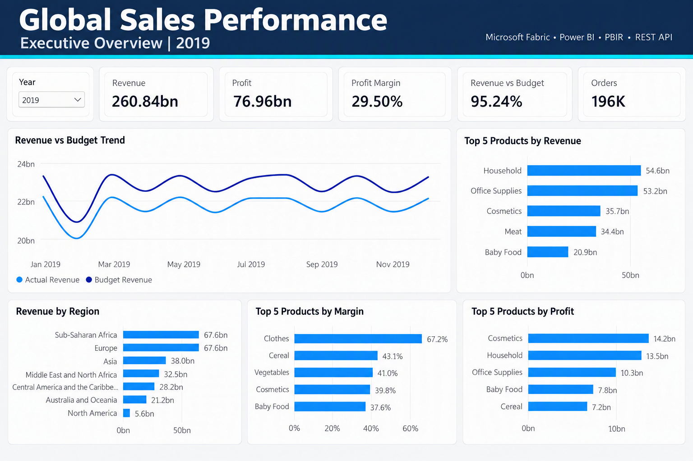
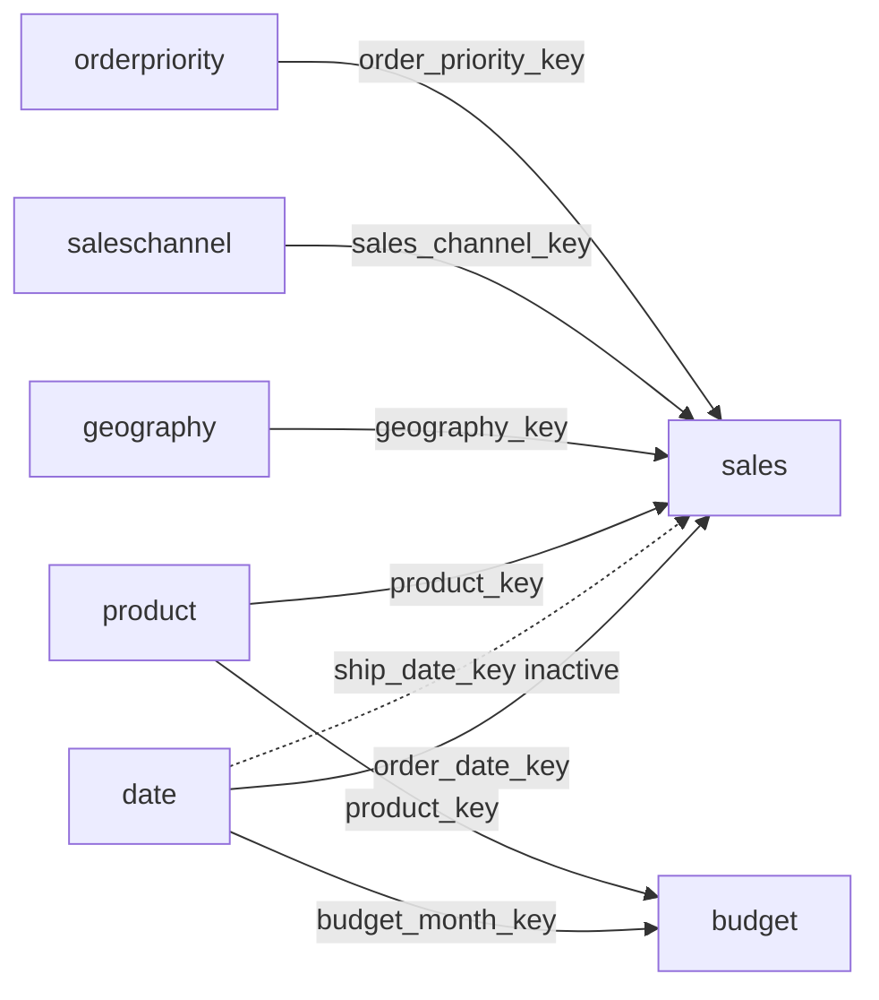
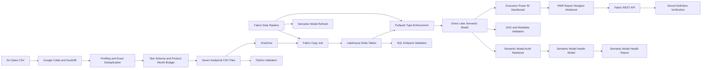
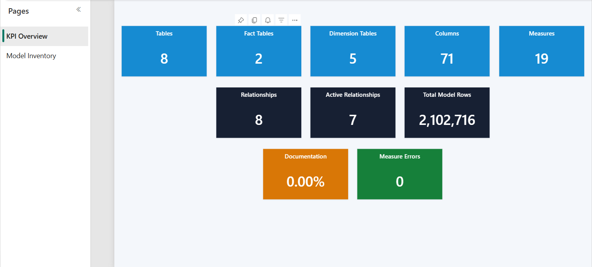
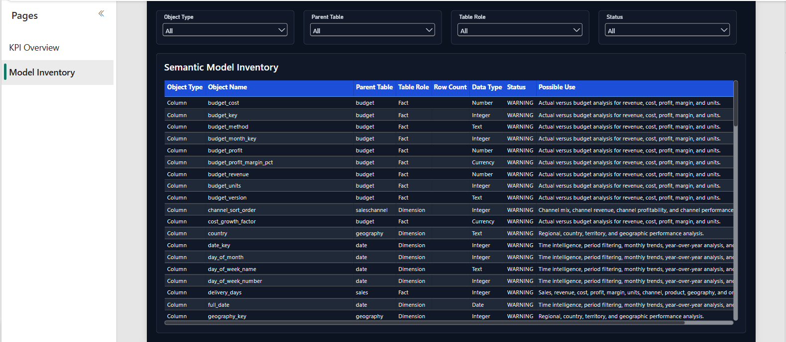

# Sales Records Fabric Analytics

[](https://www.microsoft.com/microsoft-fabric)
[](https://powerbi.microsoft.com/)
[](https://www.python.org/)
[](https://learn.microsoft.com/fabric/data-engineering/lakehouse-sql-analytics-endpoint)
[](https://learn.microsoft.com/dax/)
[](https://learn.microsoft.com/power-bi/developer/projects/projects-report)
[](LICENSE)

A validation-driven Microsoft Fabric solution that transforms a synthetic **5,000,000-row sales source** into typed Delta tables, a dimensional model, a Direct Lake semantic model, an automated Power BI executive dashboard, and a separate semantic-model health solution.

The repository demonstrates the complete analytical path from source profiling and deduplication to orchestration, semantic modeling, PBIR report engineering, Fabric REST API deployment, independent reconciliation, and Git-based documentation.



> [!NOTE]
> The source data is synthetic and intended for technical testing, data engineering, semantic modeling, report engineering, and analytics practice. It does not represent real commercial activity.

---

## Project highlights

| Area | Verified implementation |
|---|---|
| Source scale | 5,000,000 synthetic sales rows |
| Valid analytical transactions | 2,097,152 |
| Exact duplicates removed | 2,902,848 |
| Analytical model | 2 fact tables and 5 shared dimensions |
| Storage | Microsoft Fabric Lakehouse and Delta tables |
| Orchestration | Copy Job, Data Pipeline, and PySpark notebook |
| Semantic layer | Direct Lake semantic model with reusable DAX measures |
| Business report | 1 Power BI page: `Executive Overview` |
| Report definition | 11 PBIR visual definitions on a `1280 × 720` canvas |
| Automation | Python, PBIR JSON, and Microsoft Fabric REST APIs |
| Model governance | Separate semantic-model audit notebook, model, and report |
| Validation | DuckDB, Python, SQL, DAX, DAX Studio, SSMS, Tabular Editor, and PBIR checks |
| Repository assets | 10 Fabric item definitions, 9 PNG images, and 1 PowerPoint presentation |

---

## Why this repository is different

This is not only a Power BI dashboard repository.

The implementation treats data quality, schema enforcement, semantic-model design, report definitions, API deployment, and verification as parts of one engineered system. Critical results are reconciled through independent tools instead of being accepted from a single execution engine.

The repository is relevant to:

- **Data engineers** evaluating ingestion, deduplication, Delta storage, PySpark typing, and orchestration.
- **Analytics engineers** reviewing dimensional modeling, Actual-versus-Budget logic, validation, and reconciliation.
- **Power BI developers** working with Direct Lake, DAX, TMDL, PBIR, and programmatic report definitions.
- **Solution architects** assessing separation of concerns, deployment controls, reproducibility, and operational constraints.
- **Recruiters and technical reviewers** looking for evidence of an end-to-end Microsoft Fabric implementation rather than isolated screenshots.

---

## Business outcomes

The solution supports:

- executive monitoring of revenue, profit, margin, orders, and budget attainment;
- monthly Actual-versus-Budget analysis;
- product and regional contribution analysis;
- Top 5 product rankings by revenue, profit, and margin;
- independent verification of business totals;
- repeatable inspection of semantic-model structure and health.

---

## Source investigation and data quality

The original source was a flat CSV containing **5,000,000 synthetic sales records**.

| Validation check | Result |
|---|---:|
| Original source rows | 5,000,000 |
| Distinct complete rows | 2,097,152 |
| Exact duplicate rows | 2,902,848 |
| Conflicting duplicate Order IDs | 0 |
| Maximum occurrences of one Order ID | 3 |

The duplicated rows were identical across all 14 source columns. The raw source was preserved unchanged, while only exact duplicate rows were removed from the analytical output.

```text
5,000,000 original rows
- 2,902,848 exact duplicate rows
= 2,097,152 validated analytical rows
```

### Validation controls

The workflow checks:

- expected schema and source row count;
- required fields;
- duplicate Order IDs;
- exact duplicates versus conflicting records;
- positive units and nonnegative prices and costs;
- Ship Date not earlier than Order Date;
- Revenue = Units Sold × Unit Price;
- Cost = Units Sold × Unit Cost;
- Profit = Revenue − Cost;
- unique primary and surrogate keys;
- non-null foreign keys;
- zero orphan dimension references;
- unique product-month budget grain;
- reconciled source, exported, Delta, SQL, semantic-model, and report totals.

> [!IMPORTANT]
> A critical validation failure is a stop condition. Dependent processing should not continue until the failed control is understood and corrected.

---

## Dimensional and budget model

The analytical layer contains two fact tables and five shared dimensions.

| Table | Grain | Rows |
|---|---|---:|
| `sales` | One row per unique sales order | 2,097,152 |
| `budget` | One product per month | 1,404 |
| `date` | One row per calendar date | 3,956 |
| `product` | One row per product type | 12 |
| `geography` | One row per country-region combination | 185 |
| `saleschannel` | One row per sales channel | 2 |
| `orderpriority` | One row per priority | 4 |



### Budget assumptions

Budget rows are generated from prior-year product-month actuals.

| Metric | Growth factor |
|---|---:|
| Units | 1.03 |
| Revenue | 1.05 |
| Cost | 1.04 |
| Profit | Budget Revenue minus Budget Cost |

Budget comparisons begin in 2011 because 2010 provides the prior-year baseline. September 2020 is an incomplete reporting month and is excluded where a complete-period comparison is required.

---

## Solution architecture



---

## Microsoft Fabric implementation

The repository contains ten version-controlled Microsoft Fabric item definitions:

1. `Audit_Sales_Records_Semantic_Model.Notebook`
2. `CopyJob_1.CopyJob`
3. `Fix_Sales_Records_Data_Types.Notebook`
4. `Global Sales Performance Dashboard.Report`
5. `GlobalSalesReport_Designer.Notebook`
6. `Load_Sales_Records.DataPipeline`
7. `Sales Records Model.SemanticModel`
8. `SalesRecordsLakehouse.Lakehouse`
9. `Semantic Model Health Report.Report`
10. `Semantic Model Health.SemanticModel`

### Orchestration sequence

```text
Copy Job
   ↓
Data-Type Enforcement Notebook
   ↓
Semantic Model Refresh
```

The Copy Job uses `Full copy + Overwrite`, preventing duplicate appends during repeated executions. The semantic model is refreshed only after loading and type enforcement complete successfully.


### Explicit type enforcement

CSV does not preserve physical data types. The post-copy notebook therefore enforces the analytical contract before refresh.

| Column category | Target type |
|---|---|
| Fact keys | `BIGINT` |
| Dimension keys | `INT` |
| Dates | `DATE` |
| Financial values | `DECIMAL(18,2)` |
| Percentages | `DECIMAL(18,4)` |
| Budget growth factors | `DECIMAL(6,4)` |
| Weekend flag | `BOOLEAN` |
| Descriptive attributes | `STRING` |

---

## Direct Lake semantic model

`Sales Records Model` runs in Direct Lake mode over Delta tables in OneLake.

The semantic layer includes:

- two fact tables and five dimensions;
- seven active relationships;
- one inactive Ship Date relationship;
- a marked Date table;
- chronological sort rules;
- a dedicated `_Measures` table;
- Sales, Budget, Shipping, and Variance display folders.

Core measures include:

- Total Revenue, Cost, and Profit;
- Profit Margin %;
- Units Sold and Order Count;
- Average Order Value and Average Delivery Days;
- Revenue by Ship Date;
- Budget Revenue, Cost, Profit, and Units;
- Revenue and Profit variances;
- Budget attainment percentages.

Centralizing the calculations in the semantic model avoids reproducing business logic independently in report visuals.

---

## Global Sales Performance Dashboard

`Global Sales Performance Dashboard` is a focused, single-page Power BI report connected to `Sales Records Model`.

The PBIR definition confirms:

- exactly **one report page**;
- page name: **Executive Overview**;
- active page ID: `ae63e334e13ceb673ebb`;
- canvas size: **1280 × 720**;
- display option: `FitToPage`;
- **11 visual definition folders** on the page.

The dashboard presents the executive analytical view through KPI cards, Actual-versus-Budget analysis, product rankings, regional contribution, and a Year filter.

For the displayed 2019 selection:

| KPI | Value |
|---|---:|
| Revenue | 260.84bn |
| Profit | 76.96bn |
| Profit Margin | 29.50% |
| Revenue versus Budget | 95.24% |
| Orders | 196K |


The single-page design is intentional: it prioritizes the key decisions and comparisons without adding navigation or duplicating analytical content across multiple pages.

---

## PBIR and Fabric REST API automation

`GlobalSalesReport_Designer` treats the report definition as a controlled deployment artifact rather than a collection of manual UI changes.

### Workflow

```text
Retrieve report definition
        ↓
Decode InlineBase64 PBIR parts
        ↓
Inspect pages and visual definitions
        ↓
Validate report paths, visual IDs, and model binding
        ↓
Build and validate changes in memory
        ↓
Update the complete report definition
        ↓
Poll the long-running Fabric operation
        ↓
Retrieve and verify the stored report state
```

### API operations

```text
POST /v1/workspaces/{workspaceId}/reports/{reportId}/getDefinition
POST /v1/workspaces/{workspaceId}/reports/{reportId}/updateDefinition
GET  /v1/operations/{operationId}
GET  /v1/operations/{operationId}/result
```

Authentication is obtained from the Fabric notebook environment:

```python
notebookutils.credentials.getToken("pbi")
```

No access token, username, password, or client secret is hardcoded.

### Defensive controls

Before deployment, the notebook validates the current report structure and restricts the expected update scope. The workflow also prepares `rollback_request_body` from the pre-update definition, polls asynchronous operations, and checks the definition stored by Fabric after deployment.

The rollback payload remains available only during the active notebook session unless it is explicitly persisted.

---

## Semantic-model health solution

The repository separates business reporting from semantic-model inspection through:

- `Audit_Sales_Records_Semantic_Model.Notebook`;
- `Semantic Model Health.SemanticModel`;
- `Semantic Model Health Report.Report`.

This provides a dedicated analytical surface for model inventory and health results instead of mixing governance information into the business dashboard.





The health solution complements external inspection with DAX Studio, Tabular Editor, and SQL tools. It does not replace those tools.

---

## Verified results

### Sales

| Metric | Verified result |
|---|---:|
| Rows | 2,097,152 |
| Distinct orders | 2,097,152 |
| Revenue | 2,791,311,290,134.26 |
| Cost | 1,967,789,425,687.73 |
| Profit | 823,521,864,446.53 |
| Profit margin | 29.50% |
| Units sold | 10,486,803,584 |
| Average order value | 1,331,000.94 |
| Average delivery time | 25.00 days |

### Budget

| Metric | Verified result |
|---|---:|
| Rows | 1,404 |
| Revenue | 2,671,195,633,124.52 |
| Cost | 1,865,176,353,940.69 |
| Profit | 806,019,279,183.83 |
| Units | 9,844,570,623 |

### Actual versus Budget

| Metric | Verified result |
|---|---:|
| Revenue variance | 120,115,657,009.74 |
| Revenue variance % | 4.50% |
| Revenue budget attainment | 104.50% |
| Profit variance | 17,502,585,262.70 |
| Profit variance % | 2.17% |
| Profit budget attainment | 102.17% |

---

## Cross-tool validation

```text
Google Colab                    PASS
DuckDB                          PASS
Fabric Copy Job                 PASS
Fabric Notebook                 PASS
Fabric SQL Analytics Endpoint   PASS
Semantic Model Refresh          PASS
DAX Query View                  PASS
DAX Studio                      PASS
SQL Server Management Studio    PASS
Visual Studio Code / Python     PASS
Tabular Editor BPA              PASS
PBIR Report Validation          PASS
Fabric REST API Deployment      PASS
```

The purpose of this cross-tool approach is not to maximize the number of technologies used. It is to reduce the risk of validating a result only within the engine that produced it.

---

## Engineering practices

| Practice | Implementation |
|---|---|
| Raw-data preservation | Original source remains unchanged |
| Exact deduplication | Only identical complete rows are removed |
| Idempotent ingestion | Full copy with overwrite prevents duplicate appends |
| Explicit data contract | Required schema, data types, keys, grains, and totals are checked |
| Fail-fast execution | Critical validation failures stop dependent processing |
| Separation of concerns | Ingestion, typing, modeling, reporting, audit, and deployment remain separate |
| Independent reconciliation | Python, DuckDB, SQL, DAX, and report outputs are compared |
| Secure notebook authentication | Fabric-issued token is used instead of hardcoded credentials |
| Controlled PBIR update | Expected paths, IDs, binding, and update scope are validated |
| Post-deployment verification | Stored report definition is checked after the API operation |
| Rollback preparation | Pre-update definition is retained in memory as a rollback payload |
| Version control | Supported Fabric definitions are stored through native Git integration |
| Transparent limitations | Implemented and non-implemented capabilities are clearly separated |

---

## Repository inventory

| Component | Count |
|---|---:|
| Microsoft Fabric item definitions | 10 |
| Notebooks | 3 |
| Power BI reports | 2 |
| Semantic models | 2 |
| Data pipelines | 1 |
| Copy Jobs | 1 |
| Lakehouses | 1 |
| PNG documentation images | 9 |
| PowerPoint presentations | 1 |

The total number of physical files is intentionally not hardcoded. Fabric-managed folders contain generated metadata whose file count can change after synchronization even when the logical solution inventory remains unchanged.

---

## Repository structure

```text
.
├── Audit_Sales_Records_Semantic_Model.Notebook/
├── CopyJob_1.CopyJob/
├── Fix_Sales_Records_Data_Types.Notebook/
├── Global Sales Performance Dashboard.Report/
├── GlobalSalesReport_Designer.Notebook/
├── Load_Sales_Records.DataPipeline/
├── Sales Records Model.SemanticModel/
├── SalesRecordsLakehouse.Lakehouse/
├── Semantic Model Health Report.Report/
├── Semantic Model Health.SemanticModel/
├── docs/
│   └── images/
│       ├── .gitkeep
│       ├── 01_fabric_workspace.png
│       ├── 02_fabric_pipeline.png
│       ├── 03_ssms_sql_endpoint.png
│       ├── 04_dax_studio.png
│       ├── 05_tabular_editor.png
│       ├── 06_visual_studio_code.png
│       ├── global-sales-performance-dashboard.png
│       ├── semantic-model-health-kpi-overview.png
│       └── semantic-model-health-model-inventory.png
├── LICENSE
├── README.md
└── Sales-Records-Fabric-Analytics-Presentation.pptx
```

---

## Reproduction workflow

1. Download the synthetic 5m Sales Records dataset.
2. Preserve the original source without modification.
3. Profile all rows with Google Colab and DuckDB.
4. Distinguish exact duplicates from conflicting records.
5. Remove exact duplicates only.
6. Standardize column names and apply explicit data types.
7. Create surrogate keys, facts, and dimensions.
8. Generate the product-month budget.
9. Validate keys, grains, formulas, relationships, and totals.
10. Export the seven analytical CSV files.
11. Upload the files to the OneDrive `sales-records` folder.
12. Create the Fabric workspace and Lakehouse.
13. Configure the Copy Job with `Full copy + Overwrite`.
14. Run the type-enforcement notebook.
15. Refresh and validate the Direct Lake semantic model.
16. Validate results through SQL, Python, and DAX.
17. Deploy and verify the Executive Overview through the PBIR notebook.
18. Run the semantic-model audit and refresh the health solution.
19. Commit supported Fabric definitions through native Git integration.

Connections, credentials, capacity assignments, and private environment settings must be recreated outside Git.

---

## How to use this repository

### Architecture reference

Use the repository to review an end-to-end Fabric path:

```text
Source profiling
→ dimensional transformation
→ Fabric ingestion
→ Delta storage
→ Direct Lake
→ semantic model
→ Power BI
→ PBIR automation
→ semantic-model health reporting
```

### PBIR automation reference

Use `GlobalSalesReport_Designer.Notebook` as an implementation reference for retrieving, decoding, validating, updating, polling, and verifying Fabric report definitions.

### Data-quality reference

Reuse the validation pattern by replacing the expected schema, business rules, model grains, key definitions, and reconciliation totals for another source.

### Portfolio and technical-review evidence

Use the code, model definitions, screenshots, and presentation to discuss concrete design choices such as exact deduplication, overwrite-based ingestion, Direct Lake modeling, inactive date relationships, safe API updates, and independent reconciliation.

---

## Operational considerations

- CSV files do not preserve physical types, so the sequence `Copy → Type Enforcement → Validation → Refresh` is required.
- Fabric can update generated metadata during Git synchronization; all changes should be reviewed before merge.
- PBIR schemas can evolve between Power BI versions; automation must validate current paths and structures.
- Fabric report-definition updates can be asynchronous; clients must poll the operation status.
- The prepared rollback payload should be persisted securely for a production deployment process.
- OneLake data, credentials, and private connections are not stored in Git.
- Trial-capacity performance should not be treated as a production-capacity benchmark.

---

## Limitations

- The source is synthetic.
- Budget values use predefined prior-year growth assumptions.
- Budget is maintained at product-month grain only.
- Geography and channel budget allocation are outside the current scope.
- September 2020 is an incomplete reporting period.
- The business dashboard contains one Executive Overview page.
- CSV files require post-ingestion type enforcement.
- The project was developed with Microsoft Fabric Trial capacity.
- Git stores supported definitions, not OneLake data.
- Credentials and private connections must be recreated after deployment.
- PBIR structures may change between schema versions.
- The rollback request is not persisted automatically.
- Deployment pipelines and automated CI/CD validation are outside the current scope.

---

## Skills demonstrated

- Microsoft Fabric, OneLake, Lakehouse, and Delta Lake
- Fabric Data Factory, Copy Job, Data Pipeline, and Notebook
- PySpark schema enforcement
- Direct Lake semantic modeling
- Dimensional modeling and product-month budgeting
- DAX, TMDL, and inactive relationships
- Power BI Project and PBIR JSON
- Microsoft Fabric REST APIs
- Python report-definition automation
- Semantic-model auditing and health reporting
- DuckDB, SQL, and cross-engine reconciliation
- DAX Studio, Tabular Editor, SSMS, and Visual Studio Code
- Native Fabric Git integration and technical documentation

---

## Project presentation

[Download the project presentation](Sales-Records-Fabric-Analytics-Presentation.pptx)

---

## License

This project is licensed under the [MIT License](LICENSE).
