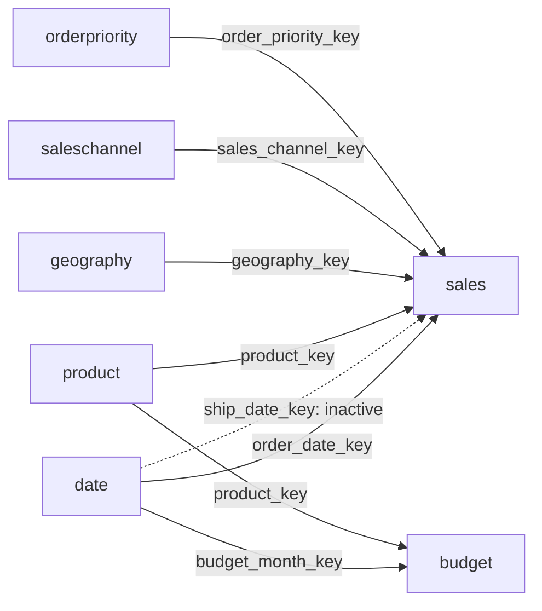
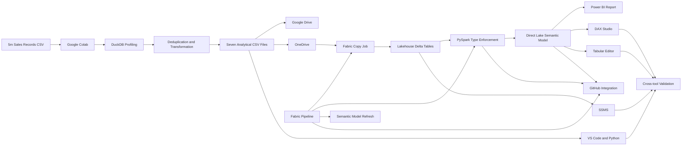
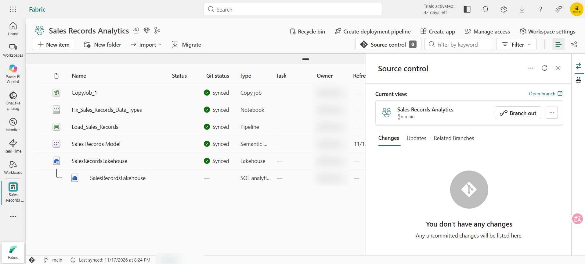

# Sales Records Fabric Analytics

[](https://www.microsoft.com/microsoft-fabric)
[](https://powerbi.microsoft.com/)
[](https://www.python.org/)
[](https://learn.microsoft.com/fabric/data-engineering/lakehouse-sql-analytics-endpoint)
[](https://learn.microsoft.com/dax/)
[](LICENSE)

An end-to-end Microsoft Fabric data engineering and analytics project that transforms a synthetic five-million-row sales dataset into a validated dimensional model with automated ingestion, Direct Lake semantic modeling, product-level budgeting, and cross-tool reconciliation.

---

## Table of contents

- [Project overview](#project-overview)
- [Business objectives](#business-objectives)
- [Source dataset](#source-dataset)
- [Data-quality discovery](#data-quality-discovery)
- [Data transformation](#data-transformation)
- [Dimensional model](#dimensional-model)
- [Solution architecture](#solution-architecture)
- [Microsoft Fabric implementation](#microsoft-fabric-implementation)
- [Direct Lake semantic model](#direct-lake-semantic-model)
- [DAX measures](#dax-measures)
- [Developer-tool integration](#developer-tool-integration)
- [Validation strategy](#validation-strategy)
- [Verified results](#verified-results)
- [Repository structure](#repository-structure)
- [Reproduction workflow](#reproduction-workflow)
- [Operational considerations](#operational-considerations)
- [Skills demonstrated](#skills-demonstrated)
- [Limitations](#limitations)
- [License](#license)

---

## Project overview

The original source was a single flat CSV file containing **5,000,000 synthetic sales records**.

The project converts that source into a governed analytical solution containing:

- a cleaned sales fact table,
- a monthly product-level budget fact table,
- five shared dimensions,
- a Microsoft Fabric Lakehouse,
- typed Delta tables,
- an automated Fabric pipeline,
- a Direct Lake semantic model,
- reusable DAX measures,
- Python, SQL, and DAX validation tests,
- GitHub-integrated Fabric definitions.

The solution was validated independently through:

- Google Colab and DuckDB,
- Microsoft Fabric Notebook and PySpark,
- SQL Server Management Studio,
- DAX Query View,
- DAX Studio,
- Tabular Editor,
- Visual Studio Code and Python.

---

## Business objectives

The project was designed to:

- transform a flat sales file into a dimensional star schema,
- identify and remove exact duplicate transactions,
- preserve valid financial totals and business keys,
- add delivery and profitability attributes,
- generate a monthly product budget,
- support Actual versus Budget analysis,
- automate ingestion from OneDrive to Microsoft Fabric,
- enforce correct Delta table data types,
- refresh the semantic model automatically,
- validate results through multiple independent engines,
- manage supported Fabric definitions through GitHub.

---

## Source dataset

The source is the synthetic **5m Sales Records** dataset:

[Download page for the Sales Records sample dataset](https://excelbianalytics.com/downloads-18-sample-csv-files-data-sets-for-testing-sales/)

The original source contains 14 columns:

- Region
- Country
- Item Type
- Sales Channel
- Order Priority
- Order Date
- Order ID
- Ship Date
- Units Sold
- Unit Price
- Unit Cost
- Total Revenue
- Total Cost
- Total Profit

> The source data is synthetic and intended for technical testing, data engineering, and analytics practice.

Large source CSV files are intentionally excluded from this repository.

---

## Data-quality discovery

Initial profiling identified a significant duplicate-data issue.

| Check | Result |
|---|---:|
| Original source rows | 5,000,000 |
| Distinct complete rows | 2,097,152 |
| Exact duplicate rows | 2,902,848 |
| Conflicting duplicate Order IDs | 0 |
| Maximum occurrences of one Order ID | 3 |

The duplicated rows were identical across all 14 source columns.

Keeping those rows would have overstated:

- total revenue,
- total cost,
- total profit,
- units sold,
- order counts,
- product performance.

The raw source remained unchanged. The analytical model was built from the **2,097,152 unique transactions**.

---

## Data transformation

Google Colab and DuckDB were used to profile, clean, transform, test, and export the source data.

### Transformation stages

1. Load and profile the five-million-row CSV.
2. Validate the expected source schema.
3. Check required values and date sequences.
4. Validate revenue, cost, and profit formulas.
5. Identify repeated Order IDs.
6. Distinguish exact duplicates from conflicting records.
7. Remove only exact duplicate rows.
8. Standardize column names using `snake_case`.
9. assign appropriate numeric and date types.
10. Create surrogate dimension keys.
11. Build the sales fact table.
12. Generate the monthly product budget.
13. Reconcile row counts and financial totals.
14. Export seven final analytical tables.

### Added analytical attributes

The sales fact table was extended with:

- `delivery_days`
- `unit_margin`
- `profit_margin_pct`

Technical surrogate keys were added to the fact and dimension tables.

---

## Dimensional model

The final model contains **two fact tables** and **five dimensions**.

### Fact tables

#### `sales`

Grain:

> One row per unique sales order.

Final row count:

```text
2,097,152
```

Key metrics:

- units sold,
- unit price,
- unit cost,
- total revenue,
- total cost,
- total profit,
- delivery days,
- unit margin,
- profit margin percentage.

#### `budget`

Grain:

> One product per month.

Final row count:

```text
1,404
```

The budget was generated from prior-year product-month performance.

| Budget metric | Growth factor |
|---|---:|
| Units | 1.03 |
| Revenue | 1.05 |
| Cost | 1.04 |
| Profit | Budget revenue minus budget cost |

The budget intentionally remains at product-month granularity. Geography, sales channel, and order priority are not native budget dimensions.

### Dimension tables

| Dimension | Purpose | Rows |
|---|---|---:|
| `date` | Continuous order and shipping calendar | 3,956 |
| `product` | Product types and reporting names | 12 |
| `geography` | Country and region combinations | 185 |
| `saleschannel` | Online and offline sales channels | 2 |
| `orderpriority` | Critical, High, Medium, and Low priorities | 4 |

---

## Star schema



The model uses:

- one-to-many relationships,
- single-direction filtering from dimensions to facts,
- an active sales order-date relationship,
- an inactive sales ship-date relationship,
- shared Date and Product dimensions for Actual versus Budget analysis.

---

## Solution architecture



---

## Microsoft Fabric implementation

### Fabric workspace

The `Sales Records Analytics` workspace contains:

- `CopyJob_1`
- `Fix_Sales_Records_Data_Types`
- `Load_Sales_Records`
- `Sales Records Model`
- `SalesRecordsLakehouse`
- Lakehouse SQL Analytics Endpoint



### Automated pipeline

The Fabric pipeline executes three activities sequentially:

```text
Copy Job
   ↓
Data-Type Enforcement Notebook
   ↓
Semantic Model Refresh
```

The Copy Job loads seven CSV files from OneDrive through the SharePoint Folder connector.

The destination uses:

```text
Full copy + Overwrite
```

This prevents repeated runs from appending duplicate copies of the same source data.


### Data-type enforcement

CSV files do not persist physical data types.

The Fabric Copy Job initially interpreted the CSV fields as strings. The `Fix_Sales_Records_Data_Types` notebook therefore converts the Lakehouse tables to the required Delta types after every copy operation.

| Column category | Target type |
|---|---|
| Technical keys | `INT` / `BIGINT` |
| Dates | `DATE` |
| Financial values | `DECIMAL(18,2)` |
| Percentage values | `DECIMAL(18,4)` |
| Boolean values | `BOOLEAN` |
| Descriptive attributes | `STRING` |

The notebook also validates the expected row count for every table and returns a final `PASS` or `FAIL abbreviated month name by month number,
- quarter name by quarter number,
- weekday name by weekday number,
- year-month by month start date.

---

## DAX measures

### Sales measures

- Total Revenue
- Total Cost
- Total Profit
- Profit Margin %
- Units Sold
- Order Count
- Average Order Value
- Average Delivery Days
- Revenue by Ship Date

### Budget measures

- Budget Revenue
- Budget Cost
- Budget Profit
- Budget Units

### Variance measures

- Revenue Variance
- Revenue Variance %
- Profit Variance
- Profit Variance %
- Revenue Budget Attainment %
- Profit Budget Attainment %

The `Revenue by Ship Date` measure uses `USERELATIONSHIP` to activate the inactive shipping-date relationship.

---

## Developer-tool integration

The project demonstrates that Microsoft Fabric can be used with established analytical and development tools.

### SQL Server Management Studio

SSMS connects to the Lakehouse SQL Analytics Endpoint.

It was used to validate:

- table row counts,
- financial totals,
- data types,
- SQL endpoint accessibility.

docs/images/03_ssms_sql_endpoint.png

### DAX Studio

DAX Studio connects to the semantic model through its XMLA endpoint.

It was used to validate:

- semantic-model row counts,
- measures,
- Actual versus Budget calculations,
- revenue, cost, and profit reconciliation,
- filter propagation through shared dimensions.

docs/images/04_dax_studio.png

### Tabular Editor

Tabular Editor was used to inspect and improve the semantic model.

Tasks included:

- inspecting table and measure metadata,
- reviewing DAX expressions,
- organizing measures into display folders,
- verifying relationships,
- running Best Practice Analyzer,
- confirming zero outstanding Best Practice issues.

docs/images/05_tabular_editor.png

### Visual Studio Code and Python

Visual Studio Code was used to validate the final local CSV files independently of Microsoft Fabric.

The Python validation script checks:

- file presence,
- expected row counts,
- revenue totals,
- cost totals,
- profit totals,
- final PASS or FAIL status.

docs/images/06_visual_studio_code.png

---

## Validation strategy

Validation was deliberately performed with multiple independent engines.

| Layer | Tool | Validation purpose |
|---|---|---|
| Source engineering | Google Colab and DuckDB | Profiling, deduplication, transformation, formula reconciliation |
| Lakehouse tables | Fabric Notebook and PySpark | Data types, schema, row counts |
| SQL endpoint | SSMS and T-SQL | Row counts and financial aggregates |
| Semantic model | DAX Query View and DAX Studio | Relationships, measures, filters, Actual versus Budget |
| Local source package | Visual Studio Code and Python | Independent CSV validation |
| Model metadata | Tabular Editor | DAX inspection and Best Practice Analyzer |

### Critical controls

The project validates:

- source row count,
- exact duplicate count,
- primary-key uniqueness,
- foreign-key completeness,
- orphan keys,
- required fields,
- order and shipping date sequences,
- nonnegative numerical values,
- revenue formulas,
- cost formulas,
- profit formulas,
- product-month budget uniqueness,
- source-to-destination row counts,
- SQL-to-DAX financial totals,
- Python-to-SQL reconciliation.

The process stops when a critical test returns `FAIL`.

---

## Verified results

### Sales

| Metric | Verified result |
|---|---:|
| Rows | 2,097,152 |
| Revenue | 2,791,311,290,134.26 |
| Cost | 1,967,789,425,687.73 |
| Profit | 823,521,864,446.53 |
| Distinct orders | 2,097,152 |

### Budget

| Metric | Verified result |
|---|---:|
| Rows | 1,404 |
| Revenue | 2,671,195,633,124.52 |
| Cost | 1,865,176,353,940.69 |
| Profit | 806,019,279,183.83 |

### Actual versus Budget

| Metric | Result |
|---|---:|
| Revenue variance | 120,115,657,009.74 |
| Revenue attainment | 104.50% |
| Profit variance | 17,502,585,262.70 |
| Profit attainment | 102.17% |

### Final validation status

```text
Google Colab                 PASS
Fabric Copy Job              PASS
Fabric Notebook              PASS
Fabric SQL Endpoint          PASS
Semantic Model Refresh       PASS
DAX Query View               PASS
DAX Studio                   PASS
SSMS                         PASS
Visual Studio Code / Python  PASS
Tabular Editor BPA           PASS
```

---

## Git integration

The Microsoft Fabric workspace is connected to this GitHub repository.

Supported Fabric definitions are synchronized with the `main` branch.

The repository includes definitions for:

- Copy Job,
- Data Pipeline,
- Notebook,
- Lakehouse,
- Semantic Model.

The following are intentionally excluded:

- OneLake data,
- source CSV files,
- credentials,
- personal access tokens,
- private connection strings,
- pipeline execution history,
- private endpoint addresses.

---

## Repository structure

```text
.
├── CopyJob_1.CopyJob/
├── Fix_Sales_Records_Data_Types.Notebook/
├── Load_Sales_Records.DataPipeline/
├── Sales Records Model.SemanticModel/
├── SalesRecordsLakehouse.Lakehouse/
├── docs/
│   └── images/
│       ├── 01_fabric_workspace.png
│       ├── 02_fabric_pipeline.png
│       ├── 03_ssms_sql_endpoint.png
│       ├── 04_dax_studio.png
│       ├── 05_tabular_editor.png
│       └── 06_visual_studio_code.png
├── LICENSE
└── README.md
```

---

## Reproduction workflow

1. Download the synthetic 5m Sales Records dataset.
2. Profile and deduplicate the source.
3. Build the fact and dimension tables.
4. Generate the product-month budget.
5. Export the final seven CSV files.
6. Upload the files to the OneDrive `sales-records` folder.
7. Create a Fabric workspace and Lakehouse.
8. Configure the Copy Job using `Full copy + Overwrite`.
9. Run the data-type enforcement notebook.
10. Create the Direct Lake semantic model.
11. Configure Date-table sorting and relationships.
12. Add and validate the DAX measures.
13. Run SQL, Python, and DAX reconciliation tests.
14. Connect the Fabric workspace to GitHub.
15. Commit the supported Fabric definitions and documentation.

---

## Operational considerations

The source remains CSV-based for portability.

Because CSV does not persist physical data types, the pipeline must retain the following sequence:

```text
Copy Job → Type Enforcement Notebook → Semantic Model Refresh
```

Running only the Copy Job could overwrite typed Delta tables with string-based columns and break numerical aggregations or relationship behavior.

---

## Skills demonstrated

- Microsoft Fabric
- OneLake
- Fabric Lakehouse
- Delta Lake
- Data Factory Pipeline
- Copy Job
- Fabric Notebook
- PySpark
- Direct Lake
- Power BI semantic modeling
- DAX
- TMDL
- SQL
- Python
- DuckDB
- Google Colab
- OneDrive
- SharePoint Folder connector
- DAX Studio
- Tabular Editor
- Best Practice Analyzer
- SQL Server Management Studio
- Visual Studio Code
- XMLA endpoint
- GitHub integration
- Data-quality testing
- Dimensional modeling
- Actual versus Budget analysis

---

## Limitations

- The source data is synthetic and does not represent real commercial activity.
- Budget values are generated from predefined prior-year growth assumptions.
- The source does not contain individual customers, physical stores, or product SKUs.
- Budget data is maintained at product-month granularity.
- Geography and channel budget allocation are outside the current scope.
- CSV files do not persist physical data types.
- The project was developed using Microsoft Fabric Trial capacity.
- Git synchronization stores supported definitions, not OneLake data.
- A Power BI report can be developed as a separate presentation layer over the validated semantic model.

---

## License

This project is licensed under the LICENSE.
